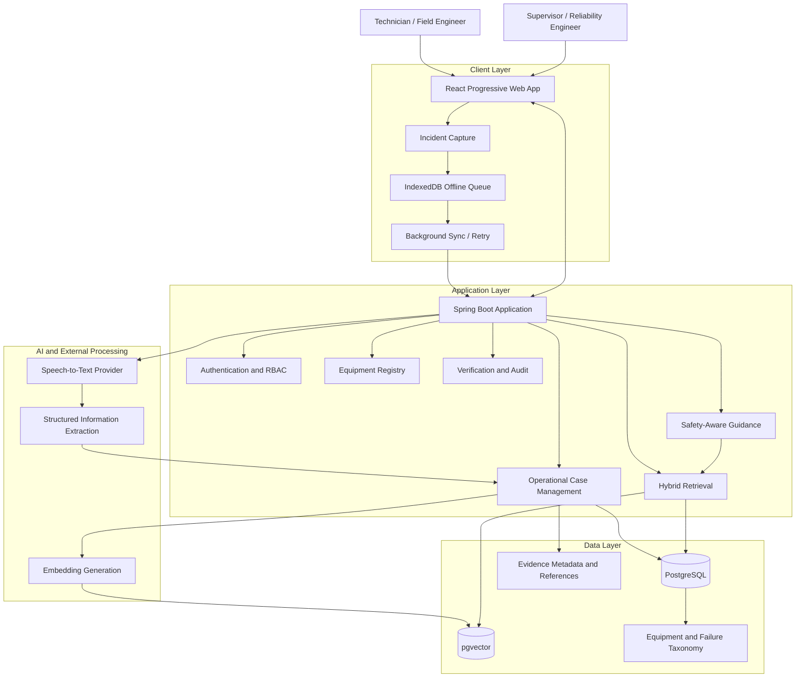

# Operational Sense

**Preserving Industrial Troubleshooting Knowledge Through Evidence-Grounded Decision Support**

Operational Sense is an industrial knowledge intelligence platform designed to capture, structure, retrieve and preserve experience-based troubleshooting knowledge.

It helps maintenance technicians and field engineers discover relevant, verified historical cases, understand the evidence behind previous troubleshooting decisions and follow appropriately controlled next-check guidance.

The product addresses a critical industrial knowledge problem: valuable troubleshooting experience is often held by individual technicians, scattered across maintenance records and difficult to reuse when experienced personnel are unavailable.

Operational Sense aims to turn that experience into a structured, searchable and continuously improving organizational knowledge asset.

---

## Contents

- [1. Product Overview](#1-product-overview)
- [2. Product Principles](#2-product-principles)
- [3. Core Capabilities](#3-core-capabilities)
- [4. System Architecture](#4-system-architecture)
- [5. Technology Stack](#5-technology-stack)
- [6. Knowledge Model and Retrieval](#6-knowledge-model-and-retrieval)
- [7. Knowledge Verification and Integrity](#7-knowledge-verification-and-integrity)
- [8. Safety-Aware Troubleshooting](#8-safety-aware-troubleshooting)
- [9. Security and Multi-Tenancy](#9-security-and-multi-tenancy)
- [10. Offline-First Capture](#10-offline-first-capture)
- [11. Repository Structure](#11-repository-structure)
- [12. Development and Setup](#12-development-and-setup)
- [13. Quality Engineering and Evaluation](#13-quality-engineering-and-evaluation)
- [14. Agile Development Approach](#14-agile-development-approach)
- [15. Documentation](#15-documentation)
- [16. Contributing](#16-contributing)
- [17. Security and Responsible Use](#17-security-and-responsible-use)
- [18. Product Scope and Roadmap](#18-product-scope-and-roadmap)
- [19. Project Status](#19-project-status)

---

## 1. Product Overview

### The problem

Industrial troubleshooting frequently depends on the practical experience of senior maintenance technicians and field engineers.

Important knowledge can remain:

- Undocumented in individual technicians' experience.
- Distributed across maintenance logs and work orders.
- Recorded in disconnected reports, photographs and videos.
- Difficult to search using the terminology of less-experienced engineers.
- Lost when experienced employees leave an organization.
- Repeatedly rediscovered when similar failures occur.

Conventional document repositories preserve files, but do not necessarily connect symptoms, equipment context, diagnostic observations, failure modes, corrective actions and verified outcomes.

### The solution

Operational Sense is designed around a continuous knowledge lifecycle:

**Capture → Structure → Retrieve → Guide → Verify → Reuse**

1. **Capture:** Technicians record operational incidents through voice, text and supporting media.
2. **Structure:** AI-assisted extraction converts observations into structured case information for human confirmation.
3. **Retrieve:** The system searches verified historical cases using equipment-aware filtering and semantic similarity.
4. **Guide:** It presents evidence-supported troubleshooting checks, subject to equipment context and safety restrictions.
5. **Verify:** Technicians record diagnostic findings, corrective actions and outcomes. Supervisors review submitted cases.
6. **Reuse:** Approved cases become part of the organization's trusted troubleshooting knowledge base.

The objective is to preserve the reasoning and evidence behind troubleshooting decisions, not simply store incident descriptions.

### Intended users

| User | Primary responsibility |
|---|---|
| Maintenance Technician | Capture incidents, review similar cases and record check results. |
| Field Engineer | Investigate equipment issues and use historical troubleshooting evidence. |
| Supervisor | Review submitted cases and verify supporting evidence. |
| Reliability Engineer | Maintain technical knowledge quality and review questionable cases. |
| Organization Administrator | Manage users, roles, organizational access and configuration. |

---

## 2. Product Principles

Operational Sense is being engineered around the following principles.

**Evidence before recommendations**

Recommendations must be grounded in relevant, verified organizational cases. The system must not fabricate historical evidence.

**Similarity is not diagnosis**

A similarity score indicates resemblance between records. It is not a diagnostic probability, confidence guarantee or authorization to intervene.

**Strict equipment context**

An actionable recommendation requires an exact equipment-class and subsystem match. Weaker matches must be clearly separated and remain informational.

**Human verification**

AI extraction does not establish ground truth. Human review and documented operational evidence determine whether a case becomes trusted knowledge.

**Safety before automation**

The system must not independently authorize intrusive maintenance actions or replace qualified engineering judgment.

**Preserve uncertainty**

Unknown, incomplete and unverified information must remain explicitly identified rather than silently inferred.

**Design for industrial connectivity**

Incident capture must accommodate unreliable network conditions and support synchronization after connectivity returns.

**Tenant isolation by design**

Organizational data boundaries must be enforced through application authorization and database-level controls.

---

## 3. Core Capabilities

The product is organized around the following capability areas.

| Capability | Product responsibility |
|---|---|
| Incident capture | Capture voice, text and supporting media. |
| Structured extraction | Extract equipment and troubleshooting information into a structured case for confirmation. |
| Equipment registry | Maintain equipment classes, models and physical equipment records. |
| Industrial taxonomy | Classify equipment, subsystems, failure modes, effects and causes. |
| Historical knowledge base | Preserve structured operational cases and their supporting evidence. |
| Hybrid retrieval | Combine exact equipment-context filtering with semantic similarity ranking. |
| Evidence presentation | Display retrieved case references, recorded models, observations and outcomes. |
| Guided troubleshooting | Present appropriately classified next checks with human confirmation. |
| Knowledge verification | Support supervisor approval, rejection, audit and revocation. |
| Offline synchronization | Persist captures locally and synchronize them when connectivity returns. |
| Organization security | Enforce role-based access and tenant-level data isolation. |

These capabilities describe the product scope. Their implementation status must be verified against the codebase and associated tests.

---

## 4. System Architecture

### Architectural approach

Operational Sense follows a modular monolith approach for its core application rather than introducing a distributed microservice architecture prematurely.

The proposed architecture uses:

- A React-based Progressive Web Application.
- A Spring Boot backend organized into business modules.
- PostgreSQL as the primary relational database.
- pgvector for vector similarity search.
- Server-side speech-to-text and structured extraction integrations.
- Browser-side IndexedDB storage for offline capture.

### Logical architecture



This is a logical architecture, not a deployment diagram. Exact implementation boundaries, external providers and deployment configuration must be maintained in the architecture documentation.

### Application responsibilities

| Component | Responsibility |
|---|---|
| React PWA | Frontline user experience and incident capture. |
| Spring Boot | Core business logic, APIs, authorization and workflow orchestration. |
| PostgreSQL | Operational cases, equipment, taxonomy, organizations and audit records. |
| pgvector | Semantic similarity search over case representations. |
| Speech-to-text integration | Convert synchronized audio into text. |
| Structured extraction | Convert observations into structured fields for technician confirmation. |
| IndexedDB | Store pending offline captures and media locally. |

The core application remains a modular monolith. External AI providers and infrastructure integrations do not imply that the business application must be split into microservices.

---

## 5. Technology Stack

The technical proposal establishes the following architecture direction.

| Layer | Technology |
|---|---|
| Frontend | React |
| Application type | Progressive Web Application (PWA) |
| Offline storage | IndexedDB |
| Backend | Java, Spring Boot |
| Database | PostgreSQL |
| Vector search | pgvector |
| Authentication | JWT-based authentication and RBAC |
| Speech processing | Server-side speech-to-text provider (selection pending) |
| AI extraction | Schema-constrained structured extraction |
| Semantic representation | Embeddings |
| Synchronization | Background Sync where supported, with polling fallback |
| Version control | Git and GitHub |
| CI/CD | Automated  workflows and CI checks |

Exact runtime versions, dependency versions and provider selections must be maintained in the service configuration and technical documentation.

No speech-to-text provider should be described as finalized until the selection and evaluation have been completed.

---

## 6. Knowledge Model and Retrieval

### Equipment-aware knowledge model

The proposed domain model separates equipment identity, operational incidents and retrieval indexing.

| Entity | Responsibility |
|---|---|
| EquipmentClass | Top-level equipment classification. |
| Subsystem | Subsystem or component classification. |
| EquipmentModel | Manufacturer and model designation, where known. |
| Equipment | Physical equipment instance linked to a model and site. |
| OperationalCase | Authoritative troubleshooting incident record. |
| HistoricalCase | Thin retrieval index referencing the authoritative case. |

`OperationalCase` remains the source of truth for case narrative, evidence, troubleshooting steps and outcomes.

`HistoricalCase` stores retrieval-related information such as case reference, embedding, equipment context, organization, status and promotion time. It should not duplicate the full case narrative.

### Case information

The MVP case structure includes:

- Equipment class.
- Subsystem.
- Equipment model, when recorded.
- Technician-reported symptom.
- Failure mode.
- Failure effect.
- Failure cause.
- Corrective action.
- Supporting diagnostic evidence.
- Troubleshooting steps and results.
- Verification status and audit information.

Project taxonomy codes are nullable. If a code cannot be assigned confidently, the text is preserved and the code remains unclassified. The system must never guess a classification.

### ISO 14224 and FMEA alignment

The data model is informed by selected ISO 14224 equipment and maintenance concepts and FMEA terminology.

The mapping separates:

- Equipment classification.
- Subsystem or maintainable-item context.
- Failure mode.
- Failure effect.
- Failure cause.
- Corrective action.

The MVP does not claim formal ISO 14224 compliance.

FMEA severity, occurrence, detection and risk-priority scoring are outside the current MVP scope.

### Hybrid retrieval strategy

Retrieval uses two principal stages.

**Stage 1 — Strict equipment filtering**

The system first filters verified historical cases using:

- Exact equipment class.
- Exact subsystem.

Both must match. A missing subsystem is not an exact match.

**Stage 2 — Semantic ranking**

The system ranks eligible cases by semantic similarity using vector embeddings.

The semantic representation uses relevant case text, including symptoms, failure modes, effects and causes.

The structured equipment filters remain explicit database constraints. Embeddings do not replace exact taxonomy matching.

### Strict and relaxed results

| Result type | Matching rule | Product treatment |
|---|---|---|
| Strict match | Same equipment class and subsystem | Eligible to support a recommendation, subject to safety rules. |
| Relaxed match | Same equipment class, different or missing subsystem | Informational background only. |
| Equipment unconfirmed | Equipment context is not confirmed | Organization-scoped background information only. |

Relaxed results must never be presented as exact subsystem matches or used to produce actionable checks.

When fewer than three strict cases exist, the interface must show only the strict cases available. Relaxed results, if displayed, must appear separately.

When no strict verified case exists, the system must explicitly communicate that no verified history is available. It must not invent an actionable recommendation.

Similarity must always be labelled as similarity, never diagnostic probability.

---

## 7. Knowledge Verification and Integrity

A captured incident does not automatically become trusted organizational knowledge.

### Case lifecycle

| Status | Meaning | Retrievable |
|---|---|---|
| `DRAFT` | Incident is being captured or prepared. | No |
| `SUBMITTED` | Case is awaiting supervisor review. | No |
| `VERIFIED` | Case has been approved with supporting evidence. | Yes |
| `REJECTED` | Case did not pass verification. | No |
| `REVOKED` | Previously verified case was subsequently found incorrect. | No |

Only `VERIFIED` cases are eligible for historical retrieval.

### Verification requirements

- Approval requires selection of the specific evidence field or troubleshooting step supporting the conclusion.
- Verification decisions must be recorded in the audit history.
- Review duration should be recorded.
- Unusually fast approvals on multi-step cases may be flagged for secondary review.
- A defined sample of approvals should undergo additional review.
- A previously verified case can be revoked when new evidence demonstrates that it is incorrect.

Revocation changes the case status rather than deleting the historical record. The case must be excluded from retrieval immediately while its history remains available for audit.

These controls reduce the risk of incorrect approvals but cannot completely eliminate human verification failures.

---

## 8. Safety-Aware Troubleshooting

Every suggested check must belong to one of the three defined safety tiers.

| Tier | Definition | Required handling |
|---|---|---|
| Tier 1 | Zero-risk visual or sensory checks | Technician may perform and record the observation. |
| Tier 2 | Non-invasive measurements | Technician may perform and record the measurement. |
| Tier 3 | Intrusive actions | Supervisor approval is required before execution. |

Examples are illustrative, not operational instructions. Actual classification must be reviewed by qualified domain personnel.

### Safety rules

1. Tier 3 actions always require supervisor approval.
2. Similarity scores never change an action's safety tier.
3. A large number of matching cases does not remove an approval requirement.
4. Only strict verified matches may support actionable next checks.
5. Relaxed matches remain informational.
6. Unconfirmed equipment context cannot produce actionable recommendations.
7. When a check could belong to two tiers, the higher tier applies.
8. Recommendations must not replace OEM instructions, site procedures, isolation requirements or qualified engineering judgment.

The product should guide technicians through one appropriately classified next check at a time, using recorded results to inform subsequent steps.

---

## 9. Security and Multi-Tenancy

Operational Sense is designed for organizational data isolation.

### Security architecture

Two layers enforce tenant boundaries:

**Application authorization**

- Organization identity is resolved server-side from the authenticated session or JWT.
- The backend must not trust a client-supplied organization ID.
- Role-based authorization controls access to product operations.

**Database-level isolation**

PostgreSQL Row-Level Security (RLS) provides a database-level backstop.

The proposed implementation includes:

- Explicit `SELECT` policies using `USING`.
- Explicit `INSERT` policies using `WITH CHECK`.
- Explicit `UPDATE` policies using both `USING` and `WITH CHECK`.
- Transaction-scoped tenant context.
- `FORCE ROW LEVEL SECURITY` on tenant-scoped tables.
- No application database role with superuser or `BYPASSRLS` privileges.
- Append-only application access to audit records.

Tenant-scoped tables include operational cases, historical retrieval records, equipment, media evidence and audit logs.

### Required security validation

Automated cross-tenant tests must cover:

- Cross-organization reads.
- Missing tenant context.
- Connection-pool context leakage.
- Cross-organization inserts.
- Unauthorized tenant reassignment during updates.
- Upsert behavior.
- Unauthorized deletes.
- Tenant isolation across all relevant tables.

Security controls must be verified through migrations, configuration checks and CI tests. Their presence in a design document alone is not evidence of implementation.

---

## 10. Offline-First Capture

Operational Sense is designed to support incident capture under unreliable network conditions.

### Capture and synchronization

1. The technician records an incident and its supporting media.
2. The client generates a unique capture ID before network activity.
3. The capture is persisted in IndexedDB.
4. The capture remains pending until synchronization succeeds.
5. Background Sync is used where supported.
6. A polling fallback handles browsers without suitable Background Sync support.
7. The server processes synchronized audio and performs structured extraction.
8. The client clears its local pending entry only after receiving the corresponding server case ID.

Transcription is server-side after synchronization in the current MVP design. On-device transcription is deferred.

### Idempotency

The network delivery model is at-least-once. The application targets one logical case per capture ID through server-side idempotency.

The design must be validated through:

- Duplicate retry tests.
- Concurrent submission tests.
- Lost-acknowledgment and application-restart tests.
- Audit and row-version side-effect tests.
- Extraction-once tests.
- RLS interaction tests.

This is a tested application behavior, not a claim of exactly-once network delivery.

### Storage limitations

IndexedDB is not guaranteed to remain durable indefinitely. Browser storage eviction and quota limitations are known risks.

The application should request persistent storage where supported, monitor available quota, handle storage errors and clearly warn users when pending captures need synchronization.

---

## 11. Repository Structure

The repository is intended to follow a modular monorepo structure.

```text

operational-sense/
│
├── README.md
├── CONTRIBUTING.md
├── CODE_OF_CONDUCT.md
├── SECURITY.md
├── LICENSE
├── CHANGELOG.md
├── SUPPORT.md
├── .gitignore
├── .gitattributes
├── .editorconfig
├── .env.example
├── Makefile
├── docker-compose.yml
│
├── .github/
│   ├── CODEOWNERS
│   ├── PULL_REQUEST_TEMPLATE.md
│   ├── ISSUE_TEMPLATE/
│   │   ├── bug_report.yml
│   │   ├── feature_request.yml
│   │   ├── research_task.yml
│   │   ├── data_quality_issue.yml
│   │   └── config.yml
│   ├── workflows/
│   │   ├── ci.yml
│   │   ├── backend-tests.yml
│   │   ├── ai-tests.yml
│   │   ├── data-validation.yml
│   │   ├── security-scan.yml
│   │   └── release.yml
│   └── dependabot.yml
│
├── docs/
│   ├── 00-project-charter/
│   │   ├── project-vision.md
│   │   ├── problem-statement.md
│   │   ├── objectives-and-scope.md
│   │   ├── stakeholders.md
│   │   └── success-metrics.md
│   │
│   ├── 01-requirements/
│   │   ├── product-requirements-document.md
│   │   ├── functional-requirements.md
│   │   ├── non-functional-requirements.md
│   │   ├── user-personas.md
│   │   ├── user-stories.md
│   │   └── acceptance-criteria.md
│   │
│   ├── 02-architecture/
│   │   ├── system-context.md
│   │   ├── high-level-design.md
│   │   ├── low-level-design.md
│   │   ├── architecture-decisions/
│   │   ├── diagrams/
│   │   ├── data-flow.md
│   │   ├── api-design.md
│   │   └── security-architecture.md
│   │
│   ├── 03-domain-knowledge/
│   │   ├── asset-hierarchy.md
│   │   ├── equipment-taxonomy.md
│   │   ├── failure-taxonomy.md
│   │   ├── fmea-methodology.md
│   │   ├── iso-14224-mapping.md
│   │   ├── domain-glossary.md
│   │   └── assumptions-and-limitations.md
│   │
│   ├── 04-data-governance/
│   │   ├── data-dictionary.md
│   │   ├── case-schema.md
│   │   ├── source-provenance-policy.md
│   │   ├── anonymization-policy.md
│   │   ├── data-quality-rules.md
│   │   └── data-acceptance-criteria.md
│   │
│   ├── 05-ai-and-retrieval/
│   │   ├── retrieval-architecture.md
│   │   ├── graph-filtering.md
│   │   ├── embedding-strategy.md
│   │   ├── ranking-strategy.md
│   │   ├── abstention-policy.md
│   │   └── evaluation-methodology.md
│   │
│   ├── 06-api-and-integration/
│   │   ├── api-contracts/
│   │   ├── integration-design.md
│   │   └── error-handling.md
│   │
│   ├── 07-testing-and-quality/
│   │   ├── test-strategy.md
│   │   ├── test-plan.md
│   │   ├── test-cases.md
│   │   ├── traceability-matrix.md
│   │   └── quality-gates.md
│   │
│   ├── 08-agile-and-delivery/
│   │   ├── product-backlog.md
│   │   ├── sprint-plan.md
│   │   ├── sprint-review.md
│   │   ├── retrospective.md
│   │   ├── decision-log.md
│   │   └── risk-and-dependency-register.md
│   │
│   ├── 09-operations/
│   │   ├── deployment-guide.md
│   │   ├── environment-setup.md
│   │   ├── monitoring-and-logging.md
│   │   ├── backup-and-recovery.md
│   │   └── troubleshooting.md
│   │
│   └── 10-reports/
│       ├── weekly-status/
│       ├── sprint-reports/
│       ├── architecture-reviews/
│       └── release-reports/
│
├── apps/
│   └── web/
│       ├── src/
│       │   ├── components/
│       │   ├── pages/
│       │   ├── features/
│       │   ├── hooks/
│       │   ├── services/
│       │   ├── types/
│       │   ├── utils/
│       │   └── styles/
│       ├── public/
│       ├── tests/
│       ├── package.json
│       └── README.md
│
├── services/
│   ├── backend/
│   │   ├── src/
│   │   │   ├── modules/
│   │   │   │   ├── assets/
│   │   │   │   ├── taxonomy/
│   │   │   │   ├── cases/
│   │   │   │   ├── sources/
│   │   │   │   ├── search/
│   │   │   │   ├── feedback/
│   │   │   │   └── users/
│   │   │   ├── middleware/
│   │   │   ├── config/
│   │   │   ├── database/
│   │   │   ├── routes/
│   │   │   └── app.ts
│   │   ├── migrations/
│   │   ├── tests/
│   │   ├── package.json
│   │   └── README.md
│   │
│   └── ai-engine/
│       ├── app/
│       │   ├── ingestion/
│       │   ├── preprocessing/
│       │   ├── taxonomy_mapping/
│       │   ├── embeddings/
│       │   ├── graph_retrieval/
│       │   ├── vector_retrieval/
│       │   ├── hybrid_retrieval/
│       │   ├── reranking/
│       │   ├── evidence/
│       │   ├── answer_generation/
│       │   └── evaluation/
│       ├── tests/
│       ├── requirements.txt
│       └── README.md
│
├── data/
│   ├── README.md
│   ├── schemas/
│   ├── taxonomy/
│   ├── raw/
│   │   └── README.md
│   ├── processed/
│   ├── validated/
│   ├── synthetic/
│   ├── evaluation/
│   └── manifests/
│
├── database/
│   ├── schema/
│   ├── migrations/
│   ├── seeds/
│   ├── indexes/
│   ├── views/
│   └── README.md
│
├── experiments/
│   ├── retrieval/
│   ├── embeddings/
│   ├── ranking/
│   ├── benchmarks/
│   └── README.md
│
├── tests/
│   ├── unit/
│   ├── integration/
│   ├── contract/
│   ├── end-to-end/
│   ├── data-quality/
│   ├── retrieval/
│   ├── security/
│   └── performance/
│
├── scripts/
│   ├── setup/
│   ├── data/
│   ├── validation/
│   ├── database/
│   └── release/
│
└── infrastructure/
    ├── docker/
    ├── deployment/
    ├── monitoring/
    └── configuration/

```

This is the proposed target organization. Existing repository paths and module names take precedence until the team formally adopts a migration plan. Directories should be introduced as their corresponding implementation is established.

---

## 12. Development and Setup

The exact local setup procedure must be maintained alongside the actual application configuration.

### Prerequisites

The expected development environment includes:

- Git
- Java Development Kit (JDK)
- Maven or the project's adopted build tool
- Node.js and npm
- PostgreSQL
- pgvector extension
- A supported browser for PWA testing

Exact versions must be recorded in the relevant configuration files.

### Setup documentation

Before publishing executable setup commands, maintainers must verify:

1. Repository clone instructions.
2. Required runtime versions.
3. Database creation and pgvector installation.
4. Environment variable configuration.
5. Database migration commands.
6. Backend startup commands.
7. Frontend installation and startup commands.
8. Test and build commands.
9. Local health-check procedures.

### Environment variables

Use `.env.example` to document required configuration without exposing credentials.

Never commit:

- Database passwords.
- JWT signing secrets.
- Speech-to-text provider credentials.
- AI provider API keys.
- Private certificates or production secrets.

**Development setup commands will be added once verified against the actual repository scripts.** Unverified commands should not be copied into this README.

---

## 13. Quality Engineering and Evaluation

Operational Sense is evaluated on whether it produces reliable, traceable and safe results—not merely whether its interface works.

### Retrieval evaluation

Sprint 4 proposes comparing hybrid retrieval against a PostgreSQL full-text-search baseline using the same labeled queries and top-three cutoff.

| Metric | Definition |
|---|---|
| Recall@3 | Proportion of test queries with at least one correct historical case in the top three. |
| MRR | Mean reciprocal rank of the first correct result, using the same top-three cutoff. |

The provisional evaluation set contains approximately 20–30 team-labeled queries, including plain-English and Hinglish-style descriptions.

The technical proposal sets a target of more than 35% relative improvement in both Recall@3 and MRR over the baseline.

This is an evaluation target, not an achieved result or performance guarantee. Raw values, query counts and small-sample limitations must be reported.

### Other acceptance targets

| Area | Proposed target | Status |
|---|---|---|
| Offline parsing | A 20-second offline voice note parsed into structured JSON within 5 seconds after synchronization begins. | Awaiting measurement |
| Retrieval presentation | Up to three strict verified cases with correct source-case and model references. | Awaiting validation |
| Retrieval improvement | More than 35% relative improvement in both Recall@3 and MRR over the baseline. | Awaiting evaluation |

### Engineering test categories

- Unit tests for business logic and validation.
- Integration tests for application and database workflows.
- API contract tests.
- Offline capture and synchronization tests.
- Idempotency and concurrency tests.
- Cross-tenant security tests.
- Retrieval correctness and ranking tests.
- Verification and revocation tests.
- Tier 3 authorization tests.
- Performance and latency tests.

Every acceptance target must have a reproducible test procedure and recorded result before it is described as achieved.

---

## 14. Agile Development Approach

Operational Sense follows an iterative Agile development approach focused on delivering validated product increments.

The engineering workflow includes:

- Prioritized product backlog and traceable requirements.
- Sprint planning with explicit goals and acceptance criteria.
- Task ownership and dependency management.
- Incremental implementation and integration.
- Peer review through pull requests.
- Automated testing and continuous integration.
- Sprint reviews and retrospectives.
- Continuous refinement of technical documentation.

### Delivery roadmap

The current technical proposal organizes implementation into four sprints.

| Sprint | Focus | Primary outcome |
|---|---|---|
| Sprint 1 | Equipment taxonomy, database schema, security foundation and seed corpus. | Structured and tenant-isolated knowledge foundation. |
| Sprint 2 | PWA capture, offline storage, synchronization and server-side extraction. | Offline-capable incident capture. |
| Sprint 3 | Strict hybrid retrieval, evidence presentation, safety tiers and verification workflow. | Evidence-grounded troubleshooting workflow. |
| Sprint 4 | Labeled evaluation and comparison against keyword retrieval. | Measured retrieval quality and documented results. |

Sprint dates, owners, task assignments and progress belong in the project-management workspace and delivery documentation.

The README should describe the development approach, not become a sprint tracker.

---

## 15. Documentation

Detailed technical specifications are maintained separately from this README.

| Documentation area | Location |
|---|---|
| Product requirements and scope | `docs/product/` |
| System architecture and decisions | `docs/architecture/` |
| Agile and engineering workflow | `docs/development/` |
| Equipment hierarchy and taxonomy | `docs/data/` |
| Case schema and data governance | `docs/data/` |
| Hybrid retrieval design | `docs/retrieval/` |
| API contracts | `docs/api/` |
| Authentication and tenant isolation | `docs/security/` |
| Testing and evaluation | `docs/quality/` |
| Deployment and operations | `docs/operations/` |

Major technical decisions should be recorded through Architecture Decision Records (ADRs), including the decision context, alternatives considered, rationale and consequences.

Each major application module should maintain its own README with module-specific setup, responsibilities, interfaces and testing instructions.

---

## 16. Contributing

Contributions should follow the repository's engineering and review standards.

The expected workflow is:

1. Identify or create an issue describing the change.
2. Review the relevant product requirement and acceptance criteria.
3. Create a focused feature, bug-fix or documentation branch.
4. Implement the change with appropriate tests.
5. Update affected documentation and schemas.
6. Open a pull request linked to the issue.
7. Obtain required peer reviews and resolve feedback.
8. Merge only after applicable CI checks pass.

Direct changes to protected production branches should not be permitted.

Detailed coding conventions, branching strategy, commit messages, review requirements and test instructions belong in [`CONTRIBUTING.md`](CONTRIBUTING.md).

---

## 17. Security and Responsible Use

Operational Sense handles operational information that may be confidential and safety-relevant.

The product must account for:

- Authentication and role-based authorization.
- Organization-level data isolation.
- Encryption in transit and at rest.
- Secure storage and access to supporting media.
- Auditability of AI suggestions and human decisions.
- Controlled use of external AI and speech services.
- Input validation and prompt-injection risk.
- Employee privacy around audio and video capture.
- Data retention and organizational requirements.

Operational Sense is a decision-support system. It does not replace qualified engineering judgment, approved maintenance procedures, OEM instructions, lockout/tagout requirements or site-specific safety controls.

Security vulnerabilities should be reported through the process documented in `SECURITY.md`.

---

## 18. Product Scope and Roadmap

### MVP focus

The initial product focuses on troubleshooting rotating industrial equipment, with an intentionally controlled scope.

The core product loop prioritizes:

- Authentication and technician/supervisor roles.
- Equipment registry.
- Mobile-first incident capture.
- Voice input and structured extraction.
- Historical case repository.
- Equipment-aware semantic retrieval.
- Evidence presentation.
- Step-by-step troubleshooting with human confirmation.
- Outcome recording.
- Supervisor verification and audit history.

### Future capabilities

The following are outside the current MVP or deferred:

- On-device transcription.
- Full predictive maintenance.
- Advanced computer vision.
- Full industrial IoT sensor integration.
- Enterprise ERP integrations.
- WhatsApp and Microsoft Teams integrations.
- Multi-site analytics.
- Formal ISO 14224 compliance.
- FMEA severity, occurrence and detection scoring.

These may be considered through future product requirements and architecture reviews.

---

## 19. Project Status

Operational Sense is under active engineering development.

This repository distinguishes between:

- **Implemented:** Present in the codebase.
- **Tested:** Verified through documented test evidence.
- **Planned:** Included in the approved implementation scope but not yet confirmed as implemented.
- **Target:** A measurable acceptance criterion awaiting evaluation.
- **Deferred:** Intentionally outside the current MVP.

The technical proposal describes intended architecture, requirements and acceptance criteria. It is not proof that those capabilities have been built.

Project status must be updated from actual implementation, merged changes, test results and reviewed evidence.

---

## Product Direction

Operational Sense aims to become a reliable industrial knowledge intelligence platform that helps organizations preserve experience-based troubleshooting knowledge, reduce dependence on individual expertise and make historical operational evidence reusable.

Its long-term value is built through the accumulation of verified organizational case history—not through AI generation alone.

**Operational Sense**

*Preserving experience. Connecting evidence. Strengthening industrial knowledge.*
