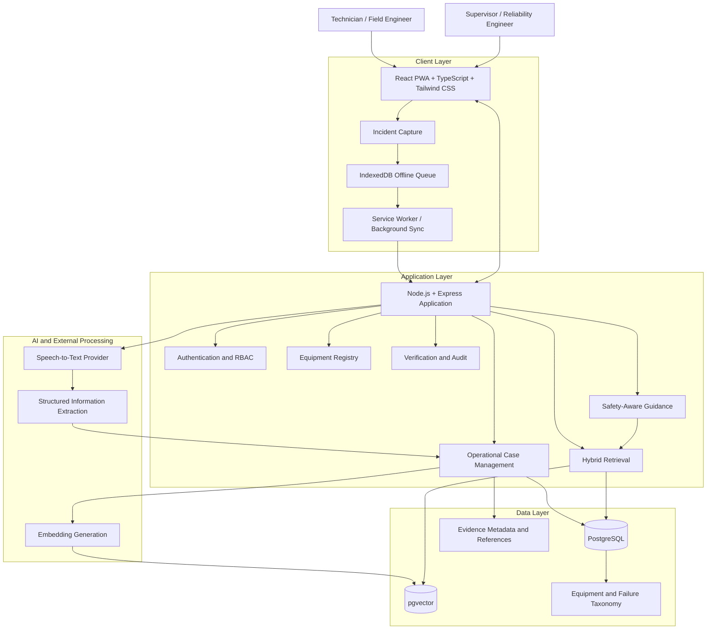

# Operational Sense

**Preserving Technicians' Tacit Troubleshooting Knowledge Through Evidence-Grounded Decision Support**

*Team Qubit | EPAM × LNCT Center of Excellence (CoE) Program | Post-Agile Workshop Refinement*

> **Elevator Pitch (One Line)**  
> *Operational Sense turns a technician's tacit, in-the-moment troubleshooting knowledge into a searchable, verified organizational asset — so expertise survives staff turnover instead of leaving with the expert.*

| Attribute | Specification |
|---|---|
| **Program** | EPAM × LNCT Center of Excellence (CoE) Program |
| **Team** | Team Qubit (LNCT Qubit) |
| **Domain** | Manufacturing / Industrial Maintenance & Field Engineering |
| **Target Stakeholders** | Machine Operators, Frontline Technicians, Maintenance/Reliability Engineers, Shift Supervisors, Plant Managers, IT/Security |
| **Core Value Proposition** | Human-in-the-loop decision-support system capturing spoken technician observations (<30s), extracting structured symptom-cause cases, retrieving semantically similar historical failures, and suggesting low-risk next checks with supervisor sign-off before case reuse. |
| **Architectural Boundary** | Complements existing enterprise CMMS (SAP PM, IBM Maximo, SOPs, ticketing) rather than attempting to replace core enterprise systems. |

---

## Contents

- [1. Product Overview](#1-product-overview)
- [2. Product Principles & Blind-Spot Defenses](#2-product-principles--blind-spot-defenses)
- [3. Core Capabilities](#3-core-capabilities)
- [4. System Architecture](#4-system-architecture)
- [5. Technology Stack](#5-technology-stack)
- [6. Knowledge Model and Retrieval](#6-knowledge-model-and-retrieval)
- [7. Knowledge Verification and Integrity](#7-knowledge-verification-and-integrity)
- [8. Safety-Aware Troubleshooting](#8-safety-aware-troubleshooting)
- [9. Security and Multi-Tenancy](#9-security-and-multi-tenancy)
- [10. Offline-First Capture](#10-offline-first-capture)
- [11. Repository Structure](#11-repository-structure)
- [12. Development and Setup](#12-development-and-setup)
- [13. Quality Engineering and Evaluation](#13-quality-engineering-and-evaluation)
- [14. Agile Development Approach](#14-agile-development-approach)
- [15. Documentation](#15-documentation)
- [16. Contributing](#16-contributing)
- [17. Security and Responsible Use](#17-security-and-responsible-use)
- [18. Product Scope and Roadmap](#18-product-scope-and-roadmap)
- [19. Project Status](#19-project-status)

---

## 1. Product Overview

### Problem Statement

Manufacturing and industrial maintenance organizations depend on experienced technicians and machine operators whose diagnostic judgment — recognizing an abnormal sound, vibration, or sensory pattern — is rarely documented anywhere. This tacit, experience-based knowledge exists only in individual memory, and is lost the moment that person retires, transfers, or is simply off-shift. 

Junior technicians facing the same symptom have no equivalent reference and fall back on trial-and-error, escalation calls, or guesswork — slower, inconsistent, and occasionally unsafe. Existing systems (CMMS, SOPs, ticketing, shared drives) manage structured work and documents well, but none are designed to capture sensory observations or retrieve knowledge by symptom similarity rather than exact keywords — so the vocabulary mismatch between a junior's and an expert's description of the same fault defeats keyword search entirely.

### Target Users and Stakeholders

| Role | Relationship to the Problem |
|---|---|
| **Machine operators & frontline technicians (primary users)** | Experience the problem daily — need faster, evidence-backed troubleshooting. |
| **Maintenance / reliability engineers** | Own repeat-failure and RCA outcomes; need reusable diagnostic history. |
| **Shift supervisors** | Verify outcomes; accountable for downtime and escalation load. |
| **Plant / operations managers (buyers)** | Accountable for MTTR, downtime cost, and knowledge-continuity risk. |
| **IT & security stakeholders** | Own data integration, residency, and AI-usage approval. |

### Purpose

To convert tacit, experience-based troubleshooting knowledge — currently trapped in individual memory — into a structured, searchable, verified organizational asset, so that any technician (not just the one expert who happens to be on shift) can access evidence-backed guidance at the moment they need it. The purpose is not to automate diagnosis or replace human judgment, but to make the organization's own accumulated experience reusable, continuous, and resilient to staff turnover.

### Expected Value (Pilot-Phase KPIs)

- **Faster diagnosis:** Reduced mean time to resolution (MTTR) and mean time to diagnose (MTTD), by surfacing genuinely similar past cases instead of starting from zero.
- **Reduced repeat failures:** Verified troubleshooting paths and RCA findings get reused instead of re-investigated each time.
- **Faster onboarding:** Junior technicians inherit the plant's real diagnostic history, not just generic manuals.
- **Reduced expert dependency:** Critical knowledge survives attrition, transfers, and shift gaps instead of leaving with the person.
- **Compounding organizational asset:** The verified case history grows more valuable, and more defensible, the longer the organization uses it.

*All values above are proposed as pilot-phase KPIs to be measured against a real baseline — not pre-committed figures.*

### The solution lifecycle

Operational Sense operates across a closed-loop knowledge lifecycle:

**Capture → Structure → Retrieve → Guide → Verify → Reuse**

1. **Capture:** Technicians capture frontline incidents via mobile voice notes (<30s), text, and supporting media, functioning fully offline in connectivity-starved areas.
2. **Structure:** AI-assisted extraction parses spoken colloquial observations into structured symptom-cause-action fields for human confirmation.
3. **Retrieve:** A two-stage hybrid pipeline filters candidates by exact equipment hierarchy before applying dense vector similarity.
4. **Guide:** Falsification-based troubleshooting presents prioritized low-risk, non-destructive checks (Tier 1 visual → Tier 2 non-invasive measurement) with mandatory supervisor approval for intrusive actions (Tier 3).
5. **Verify:** Technicians record observations and outcomes. Supervisors review and sign off on submitted cases before case promotion.
6. **Reuse:** Approved cases enter the organization's verified vector knowledge base, continuously compounding operational intelligence.

---

## 2. Product Principles & Blind-Spot Defenses

### Foundational engineering principles

- **Similarity is not diagnosis:** A mathematical vector similarity score indicates syntactic/semantic resemblance between records. It is never an automated diagnosis, statistical guarantee, or authorization to dismantle machinery.
- **Evidence before recommendations:** Suggestions must cite specific, verified historical cases. The system must never hallucinate synthetic operational advice.
- **Strict equipment context:** An actionable recommendation requires an exact equipment-class and subsystem match. Weaker matches remain strictly informational.
- **Human verification gate:** AI extraction never establishes ground truth. Human expert sign-off and documented operational evidence gate knowledge base inclusion.
- **Safety before automation:** The design prioritizes checks by an Effort/Risk ratio (not yet implemented); high-risk intrusive actions require supervisor authorization (enforced in the database for Tier 3 steps).
- **Tenant isolation by design:** Multi-tenant plant data is strictly isolated via database-level Row-Level Security (RLS).

### Critical industrial blind spots & architectural defenses

| Industrial Blind Spot | Real-World Failure Mode | Operational Sense Architectural Defense |
|---|---|---|
| **1. Vocabulary Mismatch vs. Hierarchical Context** | Pure dense vector search confuses synonyms across machines (e.g., retrieving a vibration match from a centrifuge when servicing a centrifugal slurry pump), causing hazardous cross-equipment advice. | **Two-Stage Hybrid Retrieval Pipeline:** Vector search is never global. A deterministic Graph Filter (Hard Constraint) first isolates the exact asset class and subsystem (project-local taxonomy informed by ISO 14224 concepts; no ISO 14224 compliance is claimed). Dense vector similarity (Soft Constraint) runs only within this filtered subgraph. |
| **2. Shop-Floor Connectivity Realities ("The Basement Boiler Room Problem")** | Factory floors, boiler pits, and offshore decks frequently have zero cellular coverage and strict Wi-Fi firewalls, rendering cloud-only web applications unusable. | **Offline-First PWA with Local Voice Buffer:** Built as an offline-first Progressive Web App (PWA) using IndexedDB and Service Workers. Technicians record voice notes and notes completely offline. Background sync offloads the payload and triggers server-side speech-to-text transcription upon reconnection (provider selection pending; Whisper is under evaluation, not selected). |
| **3. Knowledge Base Poisoning via Unverified Feedback Loops** | Junior technicians record incorrect fixes, and time-pressured supervisors rubber-stamp approvals, contaminating the vector retrieval corpus with bad advice. | **Strict Quarantine Gate & Review Audit Telemetry:** Newly captured cases are intended to enter as `DRAFT` / `SUBMITTED` and remain quarantined (`retrieval_eligibility = 'demo_only_until_expert_review'`). In the current synthetic corpus, all 50 cases remain DRAFT/demo-only. Unapproved cases are excluded from retrieval. The design intends to log reviewer identity, timestamp, and review duration (`verification_duration_seconds` exists as a column) so unusually fast approvals can be flagged; the flagging logic is not implemented. |

---

## 3. Core Capabilities

The product is organized around the following capability areas.

| Capability | Product responsibility |
|---|---|
| Incident capture | Capture voice, text and supporting media. |
| Structured extraction | Extract equipment and troubleshooting information into a structured case for confirmation. |
| Equipment registry | Maintain equipment classes, models and physical equipment records. |
| Industrial taxonomy | Classify equipment, subsystems, failure modes, effects and causes. |
| Historical knowledge base | Preserve structured operational cases and their supporting evidence. |
| Hybrid retrieval | Combine exact equipment-context filtering with semantic similarity ranking. |
| Evidence presentation | Display retrieved case references, recorded models, observations and outcomes. |
| Guided troubleshooting | Present appropriately classified next checks with human confirmation. |
| Knowledge verification | Support supervisor approval, rejection, audit and revocation. |
| Offline synchronization | Persist captures locally and synchronize them when connectivity returns. |
| Organization security | Enforce role-based access and tenant-level data isolation. |

These capabilities describe the product scope. Their implementation status must be verified against the codebase and associated tests.

---

## 4. System Architecture

### Architectural approach

Operational Sense follows a modular monolith approach for its core application rather than introducing a distributed microservice architecture prematurely.

The selected architecture uses:

- A React + TypeScript Progressive Web Application styled with Tailwind CSS.
- A Node.js + Express backend organized into business modules.
- PostgreSQL as the primary relational database.
- pgvector for vector similarity search.
- Server-side speech-to-text and structured extraction integrations.
- Browser-side IndexedDB storage for offline capture with Service Worker background sync.

### Logical architecture



This is a logical architecture, not a deployment diagram. Exact implementation boundaries, external providers and deployment configuration must be maintained in the architecture documentation.

### Application responsibilities

| Component | Responsibility |
|---|---|
| React PWA (TypeScript + Tailwind CSS) | Frontline user experience and incident capture. |
| Node.js + Express | Core business logic, APIs, authorization and workflow orchestration. |
| Python AI/retrieval processing | Case validation, embedding-text construction, ingestion and similarity-search workflows. Its runtime boundary with the Node.js backend is not yet defined. |
| Sentence Transformers | Generates embeddings with the configured model (real inference pending). |
| PostgreSQL | Operational cases, equipment, taxonomy, organizations and audit records. |
| pgvector | Semantic similarity search over case representations. |
| Speech-to-text integration | Convert synchronized audio into text. |
| Structured extraction | Convert observations into structured fields for technician confirmation. |
| IndexedDB + Service Worker | Store pending offline captures and media locally; synchronize on reconnection. |

The core application remains a modular monolith. External AI providers and infrastructure integrations do not imply that the business application must be split into microservices.

---

## 5. Technology Stack

Status labels: **Implemented** = built and documented by the owning workstream; **Selected** = chosen in the project proposal (implementation status is reported by the owning workstream, not restated here); **Planned** = scheduled for a later sprint; **Pending** = decision not yet made. Each workstream's own report is the authority for its status.

| Layer | Technology | Status |
|---|---|---|
| Frontend | React + TypeScript, Tailwind CSS, Progressive Web App | Selected |
| Offline capture | IndexedDB + Service Worker (Background Sync where supported, polling fallback) | Planned (Sprint 2) |
| Core backend | Node.js + Express, JWT + role-based access control (RBAC) | Selected |
| AI / retrieval processing | Python 3.10+ (syntax-checked for 3.10; test runs on 3.12/3.13) | Implemented (AI & Retrieval); mock-tested |
| Embedding model | `intfloat/multilingual-e5-small` via Sentence Transformers, 384 dimensions | Configured, provisional; real inference not yet executed |
| Primary database | PostgreSQL 16 | Schema implemented (migrations 001–008); scratch-environment runs are reported in the project evidence; the AI & Retrieval review did not re-run them |
| Vector search | pgvector extension (`vector(384)`, cosine distance `<=>`) | Implemented in SQL; exercised with mock vectors only |
| Python database access | psycopg 3 and python-dotenv | Implemented |
| Migrations | Plain SQL files applied by shell scripts (`migrate.sh`, `seed.sh`) | Implemented |
| Speech-to-text | Server-side; provider not selected (Whisper under evaluation) | Pending / Planned (Sprint 2) |
| Structured extraction | LLM with schema-constrained output; provider not selected | Planned (Sprint 2) |
| Testing | `unittest` (standard library), optional `pytest` and `jsonschema`, static-check script `tools/run_static_checks.sh` | Implemented |
| Containers / local dev | Docker Compose (`pgvector/pgvector:pg16`, bound to 127.0.0.1) | Implemented; image tag not pinned by digest yet |
| CI | GitHub Actions | Planned |
| Version control | Git + GitHub | In use |

### Python components of the AI & Retrieval layer (Group 3)

| Technology | Responsibility | Required for |
|---|---|---|
| Python 3.10+ | AI, data processing, case validation and retrieval workflows | Everything |
| Standard library only | Schema validation, dataset checks, offline pipeline and the `unittest` suite | Offline tests (no installs needed) |
| Sentence Transformers | Embedding generation with `intfloat/multilingual-e5-small` (384 dimensions; provisional; real inference pending); imported lazily | Real embedding mode only |
| psycopg 3 | PostgreSQL connectivity from Python | Live database mode only |
| python-dotenv | Loads configuration from `.env` (never committed) | Live database / embedding mode |
| pgvector (PostgreSQL extension) | Vector storage and cosine similarity search inside SQL | Live database mode |
| pgvector (Python package) | Listed in `requirements.txt` but not imported by the current code; vectors are passed as text literals with `::vector` casts. Remove it or keep it reserved for later. | Not currently needed |

Exact runtime and dependency versions are defined in `requirements.txt` and the Docker configuration, not in this README. Embeddings are generated locally by the configured model, not through an external API. No speech-to-text or LLM provider should be described as finalized until its selection and evaluation are documented.

**Model configuration clarification:** `intfloat/multilingual-e5-small` is the configured embedding model with a 384-dimensional output. No successful real-model inference has been demonstrated yet; the mock vectors used in tests must not be represented as real model embeddings.

---

## 6. Knowledge Model and Retrieval

### Equipment-aware knowledge model

The proposed domain model separates equipment identity, operational incidents and retrieval indexing.

| Entity | Responsibility |
|---|---|
| EquipmentClass | Top-level equipment classification. |
| Subsystem | Subsystem or component classification. |
| EquipmentModel | Manufacturer and model designation, where known. |
| Equipment | Physical equipment instance linked to a model and site. |
| OperationalCase | Authoritative troubleshooting incident record. |
| HistoricalCase | Thin retrieval index referencing the authoritative case. |

`OperationalCase` remains the source of truth for case narrative, evidence, troubleshooting steps and outcomes.

`HistoricalCase` stores retrieval-related information such as case reference, embedding, equipment context, organization, status and promotion time. It should not duplicate the full case narrative.

### Case information

The MVP case structure includes:

- Equipment class.
- Subsystem.
- Equipment model, when recorded.
- Technician-reported symptom.
- Failure mode.
- Failure effect.
- Failure cause.
- Corrective action.
- Supporting diagnostic evidence.
- Troubleshooting steps and results.
- Verification status and audit information.

Project taxonomy codes are nullable. If a code cannot be assigned confidently, the text is preserved and the code remains unclassified. The system must never guess a classification.

### ISO 14224 and FMEA alignment

The project uses an equipment and failure taxonomy informed by the team's reference data and FMEA-style relationships. The project does **not** claim formal ISO 14224 adoption, compliance or certification. Its failure-mode identifiers are project-local; ambiguous cross-links remain provisional pending Group 1/domain review:

- **Equipment classes represented in the synthetic corpus:** Pumps (`EQ-PUMP`), motors (`EQ-MOTOR`) and compressors (`EQ-COMP`).
- **Reference data:** The project database includes the team's subsystem and component reference records; unresolved case mappings are retained as null rather than guessed.
- **FMEA-style case fields:** Cases distinguish symptoms, suspected causes, failure mechanisms/effects and corrective actions. A suspected cause is not a confirmed root cause.

The current dataset validation reports 40/50 subsystem mappings resolved (39 exact label matches and one provisional curated rule), 10 unresolved subsystem mappings, 11 missing component names and 11 missing taxonomy codes. Thirteen taxonomy cross-links remain ambiguous/provisional. These require Group 1/domain review. The project does not claim ISO 14224 compliance or certification.

### Two-stage hybrid retrieval strategy (intended design)

The pipeline below is the intended design. In the current implementation the metadata filters and pgvector ranking exist in code and are mock-tested; real-vector retrieval is unverified. To resolve the vocabulary mismatch without risking cross-equipment hallucination, Operational Sense employs a strict two-stage retrieval pipeline:

```text
Incoming Query: "shaking heavily near 1800 RPM with high pitched whine"
                + Equipment Context: Centrifugal Pump (EQ-PUMP) / Subsystem: Bearing Assembly
                                      │
                                      ▼
┌──────────────────────────────────────────────────────────────────────────────┐
│ STAGE 1: GRAPH / METADATA FILTER (HARD CONSTRAINT)                           │
│ - Exact Match: equipment_class_id = 'EQ-PUMP'                                │
│ - Exact Match: subsystem_id = [Bearing Assembly ID]                          │
│ - Status Filter: VERIFIED and retrieval_eligibility = 'eligible'             │
│ - Tenant Guard: organization_id = [Current Tenant ID]                        │
└─────────────────────────────────────┬────────────────────────────────────────┘
                                      │ Filtered Subgraph (Eligible Verified Cases)
                                      ▼
┌──────────────────────────────────────────────────────────────────────────────┐
│ STAGE 2: DENSE VECTOR SEARCH (SOFT CONSTRAINT)                               │
│ - Embed query text (symptoms, acoustic descriptors, operating context)       │
│ - Execute pgvector cosine similarity distance (<=>) over case representations│
│ - Rank top-3 candidates with exact model and historical evidence citations  │
└──────────────────────────────────────────────────────────────────────────────┘
```

1. **Stage 1 — Graph Filter (Hard Constraint):** Filters verified historical cases using exact `equipment_class_id`, `subsystem_id`, and `case_status = 'VERIFIED'` with `retrieval_eligibility = 'eligible'`. Eliminates cross-equipment mismatches (e.g., never retrieving centrifuge vibration symptoms for a slurry pump).
2. **Stage 2 — Dense Vector Search (Soft Constraint):** The implementation ranks candidates within the filtered subset using pgvector cosine distance. Only mock-vector execution evidence exists so far; real-model ranking quality and Hinglish retrieval remain unverified.

### Strict and relaxed results (design; not yet implemented in the retrieval code)

The current retrieval code applies optional equipment-class, subsystem, model, taxonomy and synthetic-flag filters and returns up to three results; the strict/relaxed/unconfirmed result classification below is the intended product behavior and is **not yet implemented or tested**.

| Result type | Matching rule | Product treatment |
|---|---|---|
| **Strict match** | Same equipment class, exact subsystem match, verified and eligible status | Eligible to support guided troubleshooting, subject to safety tiers. |
| **Relaxed match** | Same equipment class, different or unconfirmed subsystem | Displayed separately as informational context only. Never triggers actionable checks. |
| **Equipment unconfirmed** | Equipment context missing or unverified | Organization-scoped background only; no next-step guidance generated. |

When no strict verified case exists, the system explicitly communicates that no verified history is available. It will never invent an actionable recommendation.

---

## 7. Knowledge Verification and Integrity

A captured incident does not automatically become trusted organizational knowledge.

### Case lifecycle

| Status | Meaning | Retrievable in Vector Index |
|---|---|---|
| `DRAFT` | Incident is being captured locally or extracted server-side. | No |
| `SUBMITTED` | Case submitted; awaiting supervisor technical review. | No (Quarantined) |
| `VERIFIED` | Case reviewed and approved with documented evidence. | **Yes** |
| `REJECTED` | Case rejected for incomplete or inaccurate technical data. | No |
| `REVOKED` | Previously verified case subsequently identified as incorrect. | No (Immediately Excluded) |

Only `VERIFIED` cases with `retrieval_eligibility = 'eligible'` are eligible for trusted historical retrieval. The current dataset contains no such cases; demo mode is explicitly separate and suppresses causes, actions and diagnostic steps.

### Verification requirements & anti-poisoning controls

- **Evidence Citation:** Approval requires selecting the specific diagnostic check, measurement, or photograph supporting the conclusion.
- **Audit Telemetry (intended):** Verification events are to record reviewer identity, timestamp, and review duration (`verification_duration_seconds`).
- **Anti-Rubber-Stamping (intended):** Unusually rapid approvals on multi-step complex cases are to be flagged for secondary reliability review. Not yet implemented.
- **Quarantine Enforcement:** Unapproved cases remain strictly quarantined (`retrieval_eligibility = 'demo_only_until_expert_review'`).
- **Immediate Revocation:** If a fix is found faulty post-repair, revoking the case immediately removes it from retrieval while retaining complete audit history.

---

## 8. Safety-Aware Troubleshooting

### Falsification-based guided troubleshooting protocol

Operational Sense organizes diagnostic next checks into a **Falsification-Based Protocol** prioritized by an **Effort/Risk Ratio**. Technicians are guided to falsify low-effort, low-risk hypotheses before considering intrusive teardowns:

| Tier | Category | Effort/Risk Profile | Required Handling & Authority |
|---|---|---|---|
| **Tier 1** | **Lowest-Risk Visual / Sensory Check** | Lowest effort, zero mechanical disruption (e.g., check oil sight glass, inspect foundation bolts, check for unusual chatter or thermal discoloration). | Frontline technician executes and logs observation directly in PWA. |
| **Tier 2** | **Non-Invasive Measurement** | Low effort, non-disruptive instrument reading (e.g., handheld infrared pyrometer reading, vibration pen velocity/acceleration, clamp meter current draw). | Frontline technician records calibrated measurement data. Some Tier 2 steps are isolation-sensitive: the dataset review flags 13 for safety-officer review, so Tier 2 is not automatically safe; follow site procedures. |
| **Tier 3** | **Intrusive Action** | High effort, mechanical intervention with operational risk (e.g., disassemble bearing housing, replace mechanical seal, uncouple motor). | **Supervisor Approval Required.** Enforced at database level by the PostgreSQL check constraint `chk_tier3_needs_approval`; UI enforcement is planned and not yet built. |

### Safety rules

1. **Database-Enforced Authorization:** Tier 3 actions strictly require `supervisor_approval_required = TRUE`. The database rejects any Tier 3 step missing supervisor sign-off.
2. **Similarity Invariance:** High vector similarity scores never downgrade an action's safety tier. A very high similarity score for an intrusive seal replacement still requires supervisor sign-off (a similarity score is not a probability or a percentage of correctness).
3. **Strict Match Dependency:** Only strict, verified historical matches may generate actionable next checks. Relaxed matches remain informational.
4. **Conservative Tiering:** If a diagnostic check involves ambiguous risk, the higher safety tier always applies.
5. **No Automation Override:** Operational Sense is decision-support only. It does not replace lockout/tagout (LOTO) protocols, site safety permits, or qualified engineering judgment.

---

## 9. Security and Multi-Tenancy

Operational Sense is designed for organizational data isolation.

### Security architecture

Two layers enforce tenant boundaries:

**Application authorization**

- Organization identity is resolved server-side from the authenticated session or JWT.
- The backend must not trust a client-supplied organization ID.
- Role-based authorization controls access to product operations.

**Database-level isolation**

PostgreSQL Row-Level Security (RLS) provides a database-level backstop.

The proposed implementation includes:

- Explicit `SELECT` policies using `USING`.
- Explicit `INSERT` policies using `WITH CHECK`.
- Explicit `UPDATE` policies using both `USING` and `WITH CHECK`.
- Transaction-scoped tenant context.
- `FORCE ROW LEVEL SECURITY` on tenant-scoped tables.
- No application database role with superuser or `BYPASSRLS` privileges.
- Append-only application access to audit records.

Tenant-scoped tables include operational cases, historical retrieval records, equipment, media evidence and audit logs.

### Required security validation

Automated cross-tenant tests must cover:

- Cross-organization reads.
- Missing tenant context.
- Connection-pool context leakage.
- Cross-organization inserts.
- Unauthorized tenant reassignment during updates.
- Upsert behavior.
- Unauthorized deletes.
- Tenant isolation across all relevant tables.

Security controls must be verified through migrations, configuration checks and CI tests. Their presence in a design document alone is not evidence of implementation.

---

## 10. Offline-First Capture

Operational Sense is designed to support incident capture under unreliable network conditions.

### Capture and synchronization

1. The technician records an incident and its supporting media.
2. The client generates a unique capture ID before network activity.
3. The capture is persisted in IndexedDB.
4. The capture remains pending until synchronization succeeds.
5. Background Sync is used where supported.
6. A polling fallback handles browsers without suitable Background Sync support.
7. The server processes synchronized audio and performs structured extraction.
8. The client clears its local pending entry only after receiving the corresponding server case ID.

Transcription is server-side after synchronization in the current MVP design. On-device transcription is deferred.

### Idempotency

The network delivery model is at-least-once. The application targets one logical case per capture ID through server-side idempotency.

The design must be validated through:

- Duplicate retry tests.
- Concurrent submission tests.
- Lost-acknowledgment and application-restart tests.
- Audit and row-version side-effect tests.
- Extraction-once tests.
- RLS interaction tests.

This is the **target** behavior; it is not yet implemented or tested (offline capture is planned for Sprint 2). It is not a claim of exactly-once network delivery.

### Storage limitations

IndexedDB is not guaranteed to remain durable indefinitely. Browser storage eviction and quota limitations are known risks.

The application should request persistent storage where supported, monitor available quota, handle storage errors and clearly warn users when pending captures need synchronization.

---

## 11. Repository Structure

The repository is intended to follow the modular monorepo structure below. It is a **proposed target** for the whole team; the AI & Retrieval deliverable currently uses the folders `case_schema/`, `synthetic_dataset/`, `retrieval/`, `integration/`, `poc/`, `tests/` and `documentation/` alongside the shared `database/` folder.

```text

operational-sense/
│
├── README.md
├── CONTRIBUTING.md
├── CODE_OF_CONDUCT.md
├── SECURITY.md
├── LICENSE
├── CHANGELOG.md
├── SUPPORT.md
├── .gitignore
├── .gitattributes
├── .editorconfig
├── .env.example
├── Makefile
├── docker-compose.yml
│
├── .github/
│   ├── CODEOWNERS
│   ├── PULL_REQUEST_TEMPLATE.md
│   ├── ISSUE_TEMPLATE/
│   │   ├── bug_report.yml
│   │   ├── feature_request.yml
│   │   ├── research_task.yml
│   │   ├── data_quality_issue.yml
│   │   └── config.yml
│   ├── workflows/
│   │   ├── ci.yml
│   │   ├── backend-tests.yml
│   │   ├── ai-tests.yml
│   │   ├── data-validation.yml
│   │   ├── security-scan.yml
│   │   └── release.yml
│   └── dependabot.yml
│
├── docs/
│   ├── 00-project-charter/
│   │   ├── project-vision.md
│   │   ├── problem-statement.md
│   │   ├── objectives-and-scope.md
│   │   ├── stakeholders.md
│   │   └── success-metrics.md
│   │
│   ├── 01-requirements/
│   │   ├── product-requirements-document.md
│   │   ├── functional-requirements.md
│   │   ├── non-functional-requirements.md
│   │   ├── user-personas.md
│   │   ├── user-stories.md
│   │   └── acceptance-criteria.md
│   │
│   ├── 02-architecture/
│   │   ├── system-context.md
│   │   ├── high-level-design.md
│   │   ├── low-level-design.md
│   │   ├── architecture-decisions/
│   │   ├── diagrams/
│   │   ├── data-flow.md
│   │   ├── api-design.md
│   │   └── security-architecture.md
│   │
│   ├── 03-domain-knowledge/
│   │   ├── asset-hierarchy.md
│   │   ├── equipment-taxonomy.md
│   │   ├── failure-taxonomy.md
│   │   ├── fmea-methodology.md
│   │   ├── iso-14224-mapping.md
│   │   ├── domain-glossary.md
│   │   └── assumptions-and-limitations.md
│   │
│   ├── 04-data-governance/
│   │   ├── data-dictionary.md
│   │   ├── case-schema.md
│   │   ├── source-provenance-policy.md
│   │   ├── anonymization-policy.md
│   │   ├── data-quality-rules.md
│   │   └── data-acceptance-criteria.md
│   │
│   ├── 05-ai-and-retrieval/
│   │   ├── retrieval-architecture.md
│   │   ├── graph-filtering.md
│   │   ├── embedding-strategy.md
│   │   ├── ranking-strategy.md
│   │   ├── abstention-policy.md
│   │   └── evaluation-methodology.md
│   │
│   ├── 06-api-and-integration/
│   │   ├── api-contracts/
│   │   ├── integration-design.md
│   │   └── error-handling.md
│   │
│   ├── 07-testing-and-quality/
│   │   ├── test-strategy.md
│   │   ├── test-plan.md
│   │   ├── test-cases.md
│   │   ├── traceability-matrix.md
│   │   └── quality-gates.md
│   │
│   ├── 08-agile-and-delivery/
│   │   ├── product-backlog.md
│   │   ├── sprint-plan.md
│   │   ├── sprint-review.md
│   │   ├── retrospective.md
│   │   ├── decision-log.md
│   │   └── risk-and-dependency-register.md
│   │
│   ├── 09-operations/
│   │   ├── deployment-guide.md
│   │   ├── environment-setup.md
│   │   ├── monitoring-and-logging.md
│   │   ├── backup-and-recovery.md
│   │   └── troubleshooting.md
│   │
│   └── 10-reports/
│       ├── weekly-status/
│       ├── sprint-reports/
│       ├── architecture-reviews/
│       └── release-reports/
│
├── apps/
│   └── web/
│       ├── src/
│       │   ├── components/
│       │   ├── pages/
│       │   ├── features/
│       │   ├── hooks/
│       │   ├── services/
│       │   ├── types/
│       │   ├── utils/
│       │   └── styles/
│       ├── public/
│       ├── tests/
│       ├── package.json
│       └── README.md
│
├── services/
│   ├── backend/
│   │   ├── src/
│   │   │   ├── modules/
│   │   │   │   ├── assets/
│   │   │   │   ├── taxonomy/
│   │   │   │   ├── cases/
│   │   │   │   ├── sources/
│   │   │   │   ├── search/
│   │   │   │   ├── feedback/
│   │   │   │   └── users/
│   │   │   ├── middleware/
│   │   │   ├── config/
│   │   │   ├── database/
│   │   │   ├── routes/
│   │   │   └── app.ts
│   │   ├── migrations/
│   │   ├── tests/
│   │   ├── package.json
│   │   └── README.md
│   │
│   └── ai-engine/
│       ├── app/
│       │   ├── ingestion/
│       │   ├── preprocessing/
│       │   ├── taxonomy_mapping/
│       │   ├── embeddings/
│       │   ├── graph_retrieval/
│       │   ├── vector_retrieval/
│       │   ├── hybrid_retrieval/
│       │   ├── reranking/
│       │   ├── evidence/
│       │   ├── answer_generation/
│       │   └── evaluation/
│       ├── tests/
│       ├── requirements.txt
│       └── README.md
│
├── data/
│   ├── README.md
│   ├── schemas/
│   ├── taxonomy/
│   ├── raw/
│   │   └── README.md
│   ├── processed/
│   ├── validated/
│   ├── synthetic/
│   ├── evaluation/
│   └── manifests/
│
├── database/
│   ├── schema/
│   ├── migrations/
│   ├── seeds/
│   ├── indexes/
│   ├── views/
│   └── README.md
│
├── experiments/
│   ├── retrieval/
│   ├── embeddings/
│   ├── ranking/
│   ├── benchmarks/
│   └── README.md
│
├── tests/
│   ├── unit/
│   ├── integration/
│   ├── contract/
│   ├── end-to-end/
│   ├── data-quality/
│   ├── retrieval/
│   ├── security/
│   └── performance/
│
├── scripts/
│   ├── setup/
│   ├── data/
│   ├── validation/
│   ├── database/
│   └── release/
│
└── infrastructure/
    ├── docker/
    ├── deployment/
    ├── monitoring/
    └── configuration/

```

This is the proposed target organization. Existing repository paths and module names take precedence until the team formally adopts a migration plan. Directories should be introduced as their corresponding implementation is established.

---

## 12. Development and Setup

The exact local setup procedure must be maintained alongside the actual application configuration.

### Prerequisites

The confirmed development environment requires:

- Git
- Node.js (LTS) and npm
- Docker (for the local PostgreSQL + pgvector database)
- A supported browser for PWA testing

Exact versions must be recorded in the relevant configuration files. The database is managed through Docker; a separate local PostgreSQL installation is not required for development.

### Database quick-start

The database layer is defined and can be run locally. The compose file and scripts read credentials from the environment, so create your local `.env` first (it is git-ignored; never commit it):

```bash
cp .env.example .env            # then edit: set POSTGRES_PASSWORD and OPSENSE_APP_PASSWORD (12+ characters, no placeholders)
set -a; . ./.env; set +a        # export the variables for docker compose and the scripts
cd database
docker compose up -d            # PostgreSQL 16 + pgvector, bound to 127.0.0.1 only
chmod +x scripts/*.sh
./scripts/migrate.sh            # applies migrations 001–008
./scripts/set_app_password.sh   # sets the opsense_app password from OPSENSE_APP_PASSWORD (role is created without a password)
./scripts/seed.sh               # loads reference data (3 classes, 30 components, 21 subsystems)
```

These commands come from the project's `database/README.md` and `database/scripts/`; they were **not re-run during the AI & Retrieval review** because no Docker/PostgreSQL endpoint was available there. Run them on a disposable database first.

See [`database/README.md`](database/README.md) for validation and reset instructions.

### Setup documentation

Before publishing executable setup commands for the full application, maintainers must verify:

1. Repository clone instructions.
2. Required Node.js runtime version.
3. Database setup (see above).
4. Environment variable configuration.
5. Backend installation and startup commands (`npm install`, `npm run dev`).
6. Frontend installation and startup commands.
7. Test and build commands.
8. Local health-check procedures.

### Environment variables

Use `.env.example` to document required configuration without exposing credentials.

Never commit:

- Database passwords (including `POSTGRES_PASSWORD` and `OPSENSE_APP_PASSWORD` for the `opsense_app` role).
- JWT signing secrets.
- Speech-to-text provider credentials.
- AI provider API keys.
- Private certificates or production secrets.

**Full application setup commands will be added once verified against the actual repository scripts.** Unverified commands should not be copied into this README.

---

## 13. Quality Engineering and Evaluation

Operational Sense is evaluated on whether it produces reliable, traceable and safe results—not merely whether its interface works.

### Retrieval evaluation

Sprint 4 proposes comparing hybrid retrieval against a PostgreSQL full-text-search baseline using the same labeled queries and top-three cutoff.

| Metric | Definition |
|---|---|
| Recall@3 | Proportion of test queries with at least one correct historical case in the top three. |
| MRR | Mean reciprocal rank of the first correct result, using the same top-three cutoff. |

The retrieval workstream contains 17 structurally valid evaluation queries. Approved relevance labels and a keyword-search baseline are still required; the query file's presence is not a completed benchmark.

The technical proposal sets a target of more than 35% relative improvement in both Recall@3 and MRR over the baseline.

This is an evaluation target, not an achieved result or performance guarantee. Raw values, query counts and small-sample limitations must be reported.

### Other acceptance targets

| Area | Proposed target | Status |
|---|---|---|
| Offline parsing | A 20-second offline voice note parsed into structured JSON within 5 seconds after synchronization begins. | Awaiting measurement |
| Retrieval presentation | Up to three strict verified cases with correct source-case and model references. | Awaiting validation |
| Retrieval improvement | More than 35% relative improvement in both Recall@3 and MRR over the baseline. | Awaiting evaluation |

### Engineering test categories

- Unit tests for business logic and validation.
- Integration tests for application and database workflows.
- API contract tests.
- Offline capture and synchronization tests.
- Idempotency and concurrency tests.
- Cross-tenant security tests.
- Retrieval correctness and ranking tests.
- Verification and revocation tests.
- Tier 3 authorization tests.
- Performance and latency tests.

Every acceptance target must have a reproducible test procedure and recorded result before it is described as achieved.

---

## 14. Agile Development Approach

Operational Sense follows an iterative Agile development approach focused on delivering validated product increments.

The engineering workflow includes:

- Prioritized product backlog and traceable requirements.
- Sprint planning with explicit goals and acceptance criteria.
- Task ownership and dependency management.
- Incremental implementation and integration.
- Peer review through pull requests.
- Automated testing and continuous integration.
- Sprint reviews and retrospectives.
- Continuous refinement of technical documentation.

### Delivery roadmap (EPAM 4-Sprint Phasing)

Implementation is strictly organized into four iterative delivery sprints with rigorous acceptance criteria:

| Sprint | Milestone / Deliverable | Acceptance Criteria |
|---|---|---|
| **Sprint 1: Schema & Synthetic Seed Corpus** | PostgreSQL schema with pgvector and hierarchical asset metadata; 50 synthetic illustrative cases (pumps, motors, compressors) with 350 diagnostic steps. | 50-case synthetic corpus and schema/mapping checks; no plant incident data or expert approval is implied. Multi-tenant RLS verified (11/11 tests passing). |
| **Sprint 2: Offline-First Capture & Speech-to-Text Extraction** | Mobile-responsive PWA with voice recording, offline IndexedDB queue, and server-side speech-to-text extraction (provider to be selected; Whisper under evaluation). | Technician records a 20-second voice note offline; payload syncs and parses into structured JSON upon reconnection in <5s. |
| **Sprint 3: Hybrid Search & Guided Verification Gate** | Two-stage asset-filtered semantic search with supervisor review/approval workflow and safety tier enforcement. | Search retrieves top-3 relevant past cases with exact machine model citation; unapproved cases remain strictly quarantined. |
| **Sprint 4: Evaluation Benchmark vs. Keyword Baseline** | Quantitative evaluation comparing Operational Sense against standard full-text keyword search (PostgreSQL GIN tsvector). | Demonstrate >35% higher Mean Reciprocal Rank (MRR) and Recall@3 compared to keyword search on colloquial/Hinglish technician queries. |

Sprint dates, owners, task assignments and progress belong in the project-management workspace and delivery documentation.

The README should describe the development approach, not become a sprint tracker.

---

## 15. Documentation

Detailed technical specifications are maintained separately from this README.

| Documentation area | Location (proposed numbered structure of Section 11) |
|---|---|
| Product requirements and scope | `docs/01-requirements/` |
| System architecture and decisions | `docs/02-architecture/` |
| Equipment hierarchy and taxonomy | `docs/03-domain-knowledge/` |
| Case schema and data governance | `docs/04-data-governance/` |
| Hybrid retrieval design and evaluation | `docs/05-ai-and-retrieval/` |
| API contracts | `docs/06-api-and-integration/` |
| Testing and quality | `docs/07-testing-and-quality/` |
| Agile and delivery | `docs/08-agile-and-delivery/` |
| Deployment, operations and security operations | `docs/09-operations/` |
| Workstream reports (as delivered by each group) | Each group's report folder; AI & Retrieval: `documentation/`, `synthetic_dataset/`, `embedding_strategy/` |

Major technical decisions should be recorded through Architecture Decision Records (ADRs), including the decision context, alternatives considered, rationale and consequences.

Each major application module should maintain its own README with module-specific setup, responsibilities, interfaces and testing instructions.

---

## 16. Contributing

Contributions should follow the repository's engineering and review standards.

The expected workflow is:

1. Identify or create an issue describing the change.
2. Review the relevant product requirement and acceptance criteria.
3. Create a focused feature, bug-fix or documentation branch.
4. Implement the change with appropriate tests.
5. Update affected documentation and schemas.
6. Open a pull request linked to the issue.
7. Obtain required peer reviews and resolve feedback.
8. Merge only after applicable CI checks pass.

Direct changes to protected production branches should not be permitted.

Detailed coding conventions, branching strategy, commit messages, review requirements and test instructions belong in [`CONTRIBUTING.md`](CONTRIBUTING.md).

---

## 17. Security and Responsible Use

Operational Sense handles operational information that may be confidential and safety-relevant.

The product must account for:

- Authentication and role-based authorization.
- Organization-level data isolation.
- Encryption in transit and at rest.
- Secure storage and access to supporting media.
- Auditability of AI suggestions and human decisions.
- Controlled use of external AI and speech services.
- Input validation and prompt-injection risk.
- Employee privacy around audio and video capture.
- Data retention and organizational requirements.

Operational Sense is a decision-support system. It does not replace qualified engineering judgment, approved maintenance procedures, OEM instructions, lockout/tagout requirements or site-specific safety controls.

Security vulnerabilities should be reported through the process documented in `SECURITY.md`.

---

## 18. Product Scope and Roadmap

### MVP focus

The initial product focuses on troubleshooting rotating industrial equipment, with an intentionally controlled scope.

The core product loop prioritizes:

- Authentication and technician/supervisor roles.
- Equipment registry.
- Mobile-first incident capture.
- Voice input and structured extraction.
- Historical case repository.
- Equipment-aware semantic retrieval.
- Evidence presentation.
- Step-by-step troubleshooting with human confirmation.
- Outcome recording.
- Supervisor verification and audit history.

### Future capabilities

The following are outside the current MVP or deferred:

- On-device transcription.
- Full predictive maintenance.
- Advanced computer vision.
- Full industrial IoT sensor integration.
- Enterprise ERP integrations.
- WhatsApp and Microsoft Teams integrations.
- Multi-site analytics.
- Formal ISO 14224 compliance.
- FMEA severity, occurrence and detection scoring.

These may be considered through future product requirements and architecture reviews.

---

## 19. Project Status

Operational Sense is in **Sprint 1** — actively under development.

This repository distinguishes between:

- **Implemented:** Present in the codebase.
- **Tested:** Verified through documented test evidence.
- **Planned:** Included in the approved implementation scope but not yet confirmed as implemented.
- **Target:** A measurable acceptance criterion awaiting evaluation.
- **Deferred:** Intentionally outside the current MVP.

### AI & Retrieval workstream (Group 3): evidence and current limits (30 October 2026)

*This block summarizes one workstream of the Sprint 1 team effort. Figures are as of the 2026-10-30 AI & Retrieval review and will go stale; the authoritative values are in that workstream's `synthetic_dataset/` and `documentation/` reports. Status for other workstreams is reported by their owning groups.*

The following status is limited to the supplied `Group_3_AI_Retrieval_Final_v3` package and its technical review. It does not change or certify the work owned by Groups 1, 2 or 4.

| Group 3 workstream | Evidence | Current status |
|---|---|---|
| M07 — canonical case schema | JSON Schema v1.0.0, field definitions, validation rules, semantic validator and valid/invalid samples. | Implemented; Udit's owner acceptance and downstream contract confirmation pending. |
| M08 — embeddings and retrieval | `intfloat/multilingual-e5-small` configured through sentence-transformers; configured dimension 384; E5 `query:` / `passage:` prefixes; L2 normalization; model/text provenance; pgvector cosine search and Top-3 code. | Code/configuration implemented; real model inference and actual 384-dimensional output not yet executed. Aastha and Group 2 confirmation pending. |
| M09 — synthetic case corpus | 50 unique synthetic cases: 17 pumps, 17 motors, 16 compressors; 350 ordered diagnostic steps; 19 illustrative model designations; 286 case-to-source links; 98 case-specific spare-part links. | Dataset delivered; quality/domain review partial. |
| Dataset lifecycle | All 50 cases are `is_synthetic=true`, `DRAFT`, `demo_only_until_expert_review`, with verification `PENDING`. | No case is expert-approved or eligible for trusted retrieval. |
| Offline retrieval demonstration | 50/50 cases prepared using 256-dimensional test-only mock vectors; demo mode returned mock Top-3 results; repeat mock ingestion created no duplicates. | Demonstration only. Mock scores are not meaningful real-model similarity results. |
| Evaluation | 17 evaluation queries pass structural validation; metric functions are present and tested. | Recall@3/MRR have not been benchmarked; >35% relative improvement remains a target only. |

**Open M09 data-quality items:** 10 subsystem mappings remain unresolved; 11 component names and 11 taxonomy codes are missing; 15 cases are flagged for diagnostic-depth expansion; 127 measurement-location suggestions require verification and 14 measurement points remain pending; 13 Tier-2 isolation-sensitive steps need safety-officer review; 14 safety-reference rows are general guidance, not approved plant procedures; and all 50 acceptance criteria still require OEM/site baseline verification. Thirteen taxonomy cross-links are also marked ambiguous/provisional. These items must not be silently filled or treated as approved.

**Test evidence (AI & Retrieval):** `pytest` reported 270 passed / 3 skipped; `unittest` reported 273 tests OK / 3 skipped; static checks passed. These are separate test-run reports, not a count to add together. Three live-PostgreSQL tests were skipped in the fresh audit. Archived package evidence records PostgreSQL 16.15 + pgvector 0.8.0 runs with mock vectors only; the AI & Retrieval review did not execute real model inference or fresh live database verification.

**Scope note:** Each workstream's figures in this README come from that workstream's own reports. The AI & Retrieval review did not independently re-run other groups' tests (for example database/RLS tests), so figures from other groups are quoted, not re-verified here. The AI & Retrieval data uses a project-local taxonomy and makes no ISO 14224 claim.

**Mock-vector detail:** the offline run used 256-dimensional test-only vectors; the archived PostgreSQL run used test-only mock vectors labelled 384-dimensional. Neither is a real model embedding.

**Acceptance boundary:** The AI & Retrieval workstream is internally reviewable but its acceptance matrix is **PARTIAL — not Sprint 1 accepted**. Real 384-dimensional inference, real-vector ingestion/search, fresh live pgvector verification, approved evaluation relevance labels and baseline, owner confirmations, Group 1 domain decisions, and Group 4 independent QA remain pending. Similarity is not diagnosis.

### Current implementation state (Mapped to Phasing Roadmap)

| Area | Sprint Phase | Status |
|---|---|---|
| PostgreSQL 16 + pgvector schema (migrations 001–007) | Sprint 1 | ✅ Implemented |
| Row-Level Security — 11/11 tests passing on a live database | Sprint 1 | ✅ Tested |
| Reference seed data (ISO 14224: 3 equipment classes, 21 subsystems, 30 components) | Sprint 1 | ✅ Implemented |
| Synthetic illustrative cases (50 cases + 350 tiered diagnostic steps; all DRAFT/demo-only) | Sprint 1 | 🟡 Dataset delivered; domain review partial |
| Technology stack selected (Node.js + Express, React + TypeScript + Tailwind CSS)| Sprint 1 | ✅ Confirmed |
| Backend framework wiring (Express, TypeScript compiler, linter, test runner) | Sprint 1 | 🔲 Active |
| Mobile PWA shell & IndexedDB local voice buffer | Sprint 2 | 🔲 Planned |
| Server-side speech-to-text (provider pending; Whisper under evaluation) & JSON extraction pipeline | Sprint 2 | 🔲 Planned |
| Group 3 retrieval implementation (metadata filters + pgvector cosine ranking + Top-3 response) | Sprint 3 | 🟡 Implemented in code; mock-tested; real-vector retrieval pending |
| Supervisor verification portal & quarantine gate | Sprint 3 | 🔲 Planned |
| Retrieval evaluation benchmark vs. full-text baseline (>35% target) | Sprint 4 | 🔲 Pending relevance labels, baseline and real-vector run |

The technical proposal describes intended architecture, requirements and acceptance criteria. It is not proof that those capabilities have been built.

Project status must be updated from actual implementation, merged changes, test results and reviewed evidence.

---

## Product Direction

Operational Sense aims to become a reliable industrial knowledge intelligence platform that helps organizations preserve experience-based troubleshooting knowledge, reduce dependence on individual expertise and make historical operational evidence reusable.

Its long-term value is built through the accumulation of verified organizational case history—not through AI generation alone.

**Operational Sense**

*Preserving experience. Connecting evidence. Strengthening industrial knowledge.*
