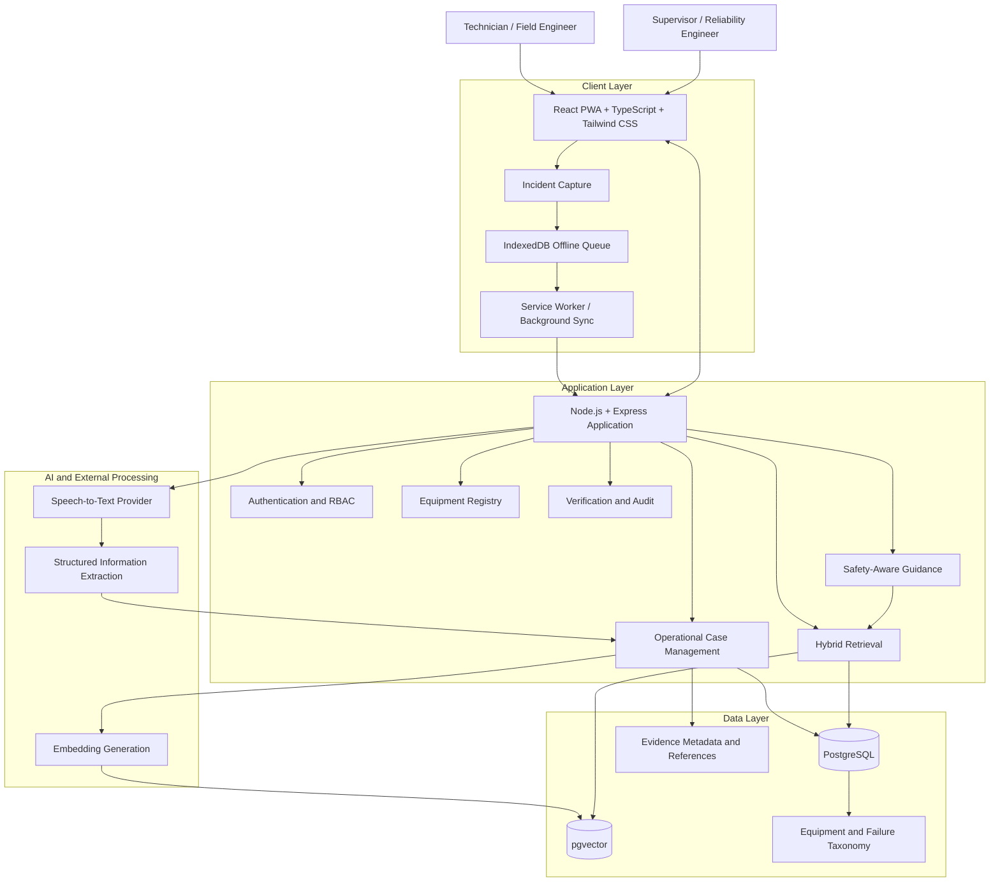

# Operational Sense

**Preserving Technicians' Tacit Troubleshooting Knowledge Through Evidence-Grounded Decision Support**

*Team Qubit | EPAM × LNCT Center of Excellence (CoE) Program | Post-Agile Workshop Refinement*

> **Elevator Pitch (One Line)**  
> *Operational Sense turns a technician's tacit, in-the-moment troubleshooting knowledge into a searchable, verified organizational asset — so expertise survives staff turnover instead of leaving with the expert.*

| Attribute | Specification |
|---|---|
| **Program** | EPAM × LNCT Center of Excellence (CoE) Program |
| **Team** | Team Qubit (LNCT Qubit) |
| **Domain** | Manufacturing / Industrial Maintenance & Field Engineering |
| **Target Stakeholders** | Machine Operators, Frontline Technicians, Maintenance/Reliability Engineers, Shift Supervisors, Plant Managers, IT/Security |
| **Core Value Proposition** | Human-in-the-loop decision-support system capturing spoken technician observations (<30s), extracting structured symptom-cause cases, retrieving semantically similar historical failures, and suggesting low-risk next checks with supervisor sign-off before case reuse. |
| **Architectural Boundary** | Complements existing enterprise CMMS (SAP PM, IBM Maximo, SOPs, ticketing) rather than attempting to replace core enterprise systems. |

---

## Contents

- [1. Product Overview](#1-product-overview)
- [2. Product Principles & Blind-Spot Defenses](#2-product-principles--blind-spot-defenses)
- [3. Core Capabilities](#3-core-capabilities)
- [4. System Architecture](#4-system-architecture)
- [5. Technology Stack](#5-technology-stack)
- [6. Knowledge Model and Retrieval](#6-knowledge-model-and-retrieval)
- [7. Knowledge Verification and Integrity](#7-knowledge-verification-and-integrity)
- [8. Safety-Aware Troubleshooting](#8-safety-aware-troubleshooting)
- [9. Security and Multi-Tenancy](#9-security-and-multi-tenancy)
- [10. Offline-First Capture](#10-offline-first-capture)
- [11. Repository Structure](#11-repository-structure)
- [12. Development and Setup](#12-development-and-setup)
- [13. Quality Engineering and Evaluation](#13-quality-engineering-and-evaluation)
- [14. Agile Development Approach](#14-agile-development-approach)
- [15. Documentation](#15-documentation)
- [16. Contributing](#16-contributing)
- [17. Security and Responsible Use](#17-security-and-responsible-use)
- [18. Product Scope and Roadmap](#18-product-scope-and-roadmap)
- [19. Project Status](#19-project-status)

---

## 1. Product Overview

### Problem Statement

Manufacturing and industrial maintenance organizations depend on experienced technicians and machine operators whose diagnostic judgment — recognizing an abnormal sound, vibration, or sensory pattern — is rarely documented anywhere. This tacit, experience-based knowledge exists only in individual memory, and is lost the moment that person retires, transfers, or is simply off-shift. 

Junior technicians facing the same symptom have no equivalent reference and fall back on trial-and-error, escalation calls, or guesswork — slower, inconsistent, and occasionally unsafe. Existing systems (CMMS, SOPs, ticketing, shared drives) manage structured work and documents well, but none are designed to capture sensory observations or retrieve knowledge by symptom similarity rather than exact keywords — so the vocabulary mismatch between a junior's and an expert's description of the same fault defeats keyword search entirely.

### Target Users and Stakeholders

| Role | Relationship to the Problem |
|---|---|
| **Machine operators & frontline technicians (primary users)** | Experience the problem daily — need faster, evidence-backed troubleshooting. |
| **Maintenance / reliability engineers** | Own repeat-failure and RCA outcomes; need reusable diagnostic history. |
| **Shift supervisors** | Verify outcomes; accountable for downtime and escalation load. |
| **Plant / operations managers (buyers)** | Accountable for MTTR, downtime cost, and knowledge-continuity risk. |
| **IT & security stakeholders** | Own data integration, residency, and AI-usage approval. |

### Purpose

To convert tacit, experience-based troubleshooting knowledge — currently trapped in individual memory — into a structured, searchable, verified organizational asset, so that any technician (not just the one expert who happens to be on shift) can access evidence-backed guidance at the moment they need it. The purpose is not to automate diagnosis or replace human judgment, but to make the organization's own accumulated experience reusable, continuous, and resilient to staff turnover.

### Expected Value (Pilot-Phase KPIs)

- **Faster diagnosis:** Reduced mean time to resolution (MTTR) and mean time to diagnose (MTTD), by surfacing genuinely similar past cases instead of starting from zero.
- **Reduced repeat failures:** Verified troubleshooting paths and RCA findings get reused instead of re-investigated each time.
- **Faster onboarding:** Junior technicians inherit the plant's real diagnostic history, not just generic manuals.
- **Reduced expert dependency:** Critical knowledge survives attrition, transfers, and shift gaps instead of leaving with the person.
- **Compounding organizational asset:** The verified case history grows more valuable, and more defensible, the longer the organization uses it.

*All values above are proposed as pilot-phase KPIs to be measured against a real baseline — not pre-committed figures.*

### The solution lifecycle

Operational Sense operates across a closed-loop knowledge lifecycle:

**Capture → Structure → Retrieve → Guide → Verify → Reuse**

1. **Capture:** Technicians capture frontline incidents via mobile voice notes (<30s), text, and supporting media, functioning fully offline in connectivity-starved areas.
2. **Structure:** AI-assisted extraction parses spoken colloquial observations into structured symptom-cause-action fields for human confirmation.
3. **Retrieve:** A two-stage hybrid pipeline filters candidates by exact equipment hierarchy before applying dense vector similarity.
4. **Guide:** Falsification-based troubleshooting presents prioritized low-risk, non-destructive checks (Tier 1 visual → Tier 2 non-invasive measurement) with mandatory supervisor approval for intrusive actions (Tier 3).
5. **Verify:** Technicians record observations and outcomes. Supervisors review and sign off on submitted cases before case promotion.
6. **Reuse:** Approved cases enter the organization's verified vector knowledge base, continuously compounding operational intelligence.

---

## 2. Product Principles & Blind-Spot Defenses

### Foundational engineering principles

- **Similarity is not diagnosis:** A mathematical vector similarity score indicates syntactic/semantic resemblance between records. It is never an automated diagnosis, statistical guarantee, or authorization to dismantle machinery.
- **Evidence before recommendations:** Suggestions must cite specific, verified historical cases. The system must never hallucinate synthetic operational advice.
- **Strict equipment context:** An actionable recommendation requires an exact equipment-class and subsystem match. Weaker matches remain strictly informational.
- **Human verification gate:** AI extraction never establishes ground truth. Human expert sign-off and documented operational evidence gate knowledge base inclusion.
- **Safety before automation:** The system enforces an Effort/Risk ratio; high-risk intrusive actions require supervisor authorization.
- **Tenant isolation by design:** Multi-tenant plant data is strictly isolated via database-level Row-Level Security (RLS).

### Critical industrial blind spots & architectural defenses

| Industrial Blind Spot | Real-World Failure Mode | Operational Sense Architectural Defense |
|---|---|---|
| **1. Vocabulary Mismatch vs. Hierarchical Context** | Pure dense vector search confuses synonyms across machines (e.g., retrieving a vibration match from a centrifuge when servicing a centrifugal slurry pump), causing hazardous cross-equipment advice. | **Two-Stage Hybrid Retrieval Pipeline:** Vector search is never global. A deterministic Graph Filter (Hard Constraint) first isolates the exact asset class and subsystem (ISO 14224 aligned). Dense vector similarity (Soft Constraint) runs only within this filtered subgraph. |
| **2. Shop-Floor Connectivity Realities ("The Basement Boiler Room Problem")** | Factory floors, boiler pits, and offshore decks frequently have zero cellular coverage and strict Wi-Fi firewalls, rendering cloud-only web applications unusable. | **Offline-First PWA with Local Voice Buffer:** Built as an offline-first Progressive Web App (PWA) using IndexedDB and Service Workers. Technicians record voice notes and notes completely offline. Background sync offloads the payload and triggers server-side Whisper transcription upon reconnection. |
| **3. Knowledge Base Poisoning via Unverified Feedback Loops** | Junior technicians record incorrect fixes, and time-pressured supervisors rubber-stamp approvals, contaminating the vector retrieval corpus with bad advice. | **Strict Quarantine Gate & Review Audit Telemetry:** All newly captured cases enter as `DRAFT` / `SUBMITTED` and are quarantined (`retrieval_eligibility = 'demo_only_until_expert_review'`). Unapproved cases are excluded from retrieval. The system logs reviewer identity, timestamp, and review duration to flag rubber-stamping. |

---

## 3. Core Capabilities

The product is organized around the following capability areas.

| Capability | Product responsibility |
|---|---|
| Incident capture | Capture voice, text and supporting media. |
| Structured extraction | Extract equipment and troubleshooting information into a structured case for confirmation. |
| Equipment registry | Maintain equipment classes, models and physical equipment records. |
| Industrial taxonomy | Classify equipment, subsystems, failure modes, effects and causes. |
| Historical knowledge base | Preserve structured operational cases and their supporting evidence. |
| Hybrid retrieval | Combine exact equipment-context filtering with semantic similarity ranking. |
| Evidence presentation | Display retrieved case references, recorded models, observations and outcomes. |
| Guided troubleshooting | Present appropriately classified next checks with human confirmation. |
| Knowledge verification | Support supervisor approval, rejection, audit and revocation. |
| Offline synchronization | Persist captures locally and synchronize them when connectivity returns. |
| Organization security | Enforce role-based access and tenant-level data isolation. |

These capabilities describe the product scope. Their implementation status must be verified against the codebase and associated tests.

---

## 4. System Architecture

### Architectural approach

Operational Sense follows a modular monolith approach for its core application rather than introducing a distributed microservice architecture prematurely.

The confirmed architecture uses:

- A React + TypeScript Progressive Web Application styled with Tailwind CSS.
- A Node.js + Express backend organized into business modules.
- PostgreSQL as the primary relational database.
- pgvector for vector similarity search.
- Server-side speech-to-text and structured extraction integrations.
- Browser-side IndexedDB storage for offline capture with Service Worker background sync.

### Logical architecture



This is a logical architecture, not a deployment diagram. Exact implementation boundaries, external providers and deployment configuration must be maintained in the architecture documentation.

### Application responsibilities

| Component | Responsibility |
|---|---|
| React PWA (TypeScript + Tailwind CSS) | Frontline user experience and incident capture. |
| Node.js + Express | Core business logic, APIs, authorization and workflow orchestration. |
| PostgreSQL | Operational cases, equipment, taxonomy, organizations and audit records. |
| pgvector | Semantic similarity search over case representations. |
| Speech-to-text integration | Convert synchronized audio into text. |
| Structured extraction | Convert observations into structured fields for technician confirmation. |
| IndexedDB + Service Worker | Store pending offline captures and media locally; synchronize on reconnection. |

The core application remains a modular monolith. External AI providers and infrastructure integrations do not imply that the business application must be split into microservices.

---

## 5. Technology Stack

| Layer | Technology |
|---|---|
| Frontend | React + TypeScript |
| Styling | Tailwind CSS |
| Application type | Progressive Web Application (PWA) |
| Offline storage | IndexedDB + Service Worker |
| Backend | Node.js + Express |
| Database | PostgreSQL |
| Vector search | pgvector |
| Authentication | JWT + role-based access control (RBAC) |
| Database migrations | Node-compatible migration runner |
| Speech processing | Server-side speech-to-text provider (selection pending) |
| AI extraction | Schema-constrained structured extraction |
| AI integration | LLM API + embeddings |
| Semantic representation | Embeddings (dimension confirmed in M08) |
| Synchronization | Background Sync where supported, with polling fallback |
| Version control | Git and GitHub |
| CI/CD | Docker + GitHub Actions |

Exact runtime versions, dependency versions and provider selections must be maintained in the service configuration and technical documentation.

No speech-to-text provider should be described as finalized until the selection and evaluation have been completed.

---

## 6. Knowledge Model and Retrieval

### Equipment-aware knowledge model

The proposed domain model separates equipment identity, operational incidents and retrieval indexing.

| Entity | Responsibility |
|---|---|
| EquipmentClass | Top-level equipment classification. |
| Subsystem | Subsystem or component classification. |
| EquipmentModel | Manufacturer and model designation, where known. |
| Equipment | Physical equipment instance linked to a model and site. |
| OperationalCase | Authoritative troubleshooting incident record. |
| HistoricalCase | Thin retrieval index referencing the authoritative case. |

`OperationalCase` remains the source of truth for case narrative, evidence, troubleshooting steps and outcomes.

`HistoricalCase` stores retrieval-related information such as case reference, embedding, equipment context, organization, status and promotion time. It should not duplicate the full case narrative.

### Case information

The MVP case structure includes:

- Equipment class.
- Subsystem.
- Equipment model, when recorded.
- Technician-reported symptom.
- Failure mode.
- Failure effect.
- Failure cause.
- Corrective action.
- Supporting diagnostic evidence.
- Troubleshooting steps and results.
- Verification status and audit information.

Project taxonomy codes are nullable. If a code cannot be assigned confidently, the text is preserved and the code remains unclassified. The system must never guess a classification.

### ISO 14224 and FMEA alignment

The data model directly adopts the taxonomy principles of **ISO 14224** (*Petroleum, petrochemical and natural gas industries — Collection and exchange of reliability and maintenance data for equipment*) and standard **Failure Mode and Effects Analysis (FMEA)**:

- **Equipment Classes (3 Initial Classes):** Centrifugal Pumps (`EQ-PUMP`), Three-Phase Induction Motors (`EQ-MOTOR`), Rotary Screw Compressors (`EQ-COMP`).
- **Subsystem & Maintainable Items:** 21 standardized subsystem records and 30 component-level definitions to enforce structural consistency.
- **FMEA Alignment:** Each failure case links symptoms to failure modes, failure mechanisms, root causes, and corrective actions.

The MVP adopts ISO 14224 structural taxonomy without claiming third-party regulatory certification. FMEA severity, occurrence, and detection calculations are reserved for future analytical expansions.

### Two-stage hybrid retrieval strategy

To resolve the vocabulary mismatch without risking cross-equipment hallucination, Operational Sense employs a strict two-stage retrieval pipeline:

```text
Incoming Query: "shaking heavily near 1800 RPM with high pitched whine"
                + Equipment Context: Centrifugal Pump (EQ-PUMP) / Subsystem: Bearing Assembly
                                      │
                                      ▼
┌──────────────────────────────────────────────────────────────────────────────┐
│ STAGE 1: GRAPH / METADATA FILTER (HARD CONSTRAINT)                           │
│ - Exact Match: equipment_class_id = 'EQ-PUMP'                                │
│ - Exact Match: subsystem_id = [Bearing Assembly ID]                          │
│ - Status Filter: status = 'VERIFIED' (Strictly excludes unverified cases)    │
│ - Tenant Guard: organization_id = [Current Tenant ID]                        │
└─────────────────────────────────────┬────────────────────────────────────────┘
                                      │ Filtered Subgraph (Eligible Verified Cases)
                                      ▼
┌──────────────────────────────────────────────────────────────────────────────┐
│ STAGE 2: DENSE VECTOR SEARCH (SOFT CONSTRAINT)                               │
│ - Embed query text (symptoms, acoustic descriptors, operating context)       │
│ - Execute pgvector cosine similarity distance (<=>) over case representations│
│ - Rank top-3 candidates with exact model and historical evidence citations  │
└──────────────────────────────────────────────────────────────────────────────┘
```

1. **Stage 1 — Graph Filter (Hard Constraint):** Filters verified historical cases using exact `equipment_class_id`, `subsystem_id`, and `status = 'VERIFIED'`. Eliminates cross-equipment mismatches (e.g., never retrieving centrifuge vibration symptoms for a slurry pump).
2. **Stage 2 — Dense Vector Search (Soft Constraint):** Ranks candidate cases within the filtered subset using pgvector cosine distance over acoustic observations, symptom text, and operating conditions.

### Strict and relaxed results

| Result type | Matching rule | Product treatment |
|---|---|---|
| **Strict match** | Same equipment class, exact subsystem match, verified status | Eligible to support guided troubleshooting, subject to safety tiers. |
| **Relaxed match** | Same equipment class, different or unconfirmed subsystem | Displayed separately as informational context only. Never triggers actionable checks. |
| **Equipment unconfirmed** | Equipment context missing or unverified | Organization-scoped background only; no next-step guidance generated. |

When no strict verified case exists, the system explicitly communicates that no verified history is available. It will never invent an actionable recommendation.

---

## 7. Knowledge Verification and Integrity

A captured incident does not automatically become trusted organizational knowledge.

### Case lifecycle

| Status | Meaning | Retrievable in Vector Index |
|---|---|---|
| `DRAFT` | Incident is being captured locally or extracted server-side. | No |
| `SUBMITTED` | Case submitted; awaiting supervisor technical review. | No (Quarantined) |
| `VERIFIED` | Case reviewed and approved with documented evidence. | **Yes** |
| `REJECTED` | Case rejected for incomplete or inaccurate technical data. | No |
| `REVOKED` | Previously verified case subsequently identified as incorrect. | No (Immediately Excluded) |

Only `VERIFIED` cases are eligible for historical retrieval.

### Verification requirements & anti-poisoning controls

- **Evidence Citation:** Approval requires selecting the specific diagnostic check, measurement, or photograph supporting the conclusion.
- **Audit Telemetry:** Verification events record reviewer identity, timestamp, and review duration (`verification_duration_seconds`).
- **Anti-Rubber-Stamping:** Unusually rapid approvals on multi-step complex cases are flagged for secondary reliability review.
- **Quarantine Enforcement:** Unapproved cases remain strictly quarantined (`retrieval_eligibility = 'demo_only_until_expert_review'`).
- **Immediate Revocation:** If a fix is found faulty post-repair, revoking the case immediately removes it from retrieval while retaining complete audit history.

---

## 8. Safety-Aware Troubleshooting

### Falsification-based guided troubleshooting protocol

Operational Sense organizes diagnostic next checks into a **Falsification-Based Protocol** prioritized by an **Effort/Risk Ratio**. Technicians are guided to falsify low-effort, low-risk hypotheses before considering intrusive teardowns:

| Tier | Category | Effort/Risk Profile | Required Handling & Authority |
|---|---|---|---|
| **Tier 1** | **Zero-Risk Visual / Sensory Check** | Lowest effort, zero mechanical disruption (e.g., check oil sight glass, inspect foundation bolts, check for unusual chatter or thermal discoloration). | Frontline technician executes and logs observation directly in PWA. |
| **Tier 2** | **Non-Invasive Measurement** | Low effort, non-disruptive instrument reading (e.g., handheld infrared pyrometer reading, vibration pen velocity/acceleration, clamp meter current draw). | Frontline technician records calibrated measurement data. |
| **Tier 3** | **Intrusive Action** | High effort, mechanical intervention with operational risk (e.g., disassemble bearing housing, replace mechanical seal, uncouple motor). | **Supervisor Approval Required.** Hard-locked in UI; enforced at database level via PostgreSQL check constraint (`chk_tier3_needs_approval`). |

### Safety rules

1. **Database-Enforced Authorization:** Tier 3 actions strictly require `supervisor_approval_required = TRUE`. The database rejects any Tier 3 step missing supervisor sign-off.
2. **Similarity Invariance:** High vector similarity scores never downgrade an action's safety tier. A 98% match for an intrusive seal replacement still requires supervisor sign-off.
3. **Strict Match Dependency:** Only strict, verified historical matches may generate actionable next checks. Relaxed matches remain informational.
4. **Conservative Tiering:** If a diagnostic check involves ambiguous risk, the higher safety tier always applies.
5. **No Automation Override:** Operational Sense is decision-support only. It does not replace lockout/tagout (LOTO) protocols, site safety permits, or qualified engineering judgment.

---

## 9. Security and Multi-Tenancy

Operational Sense is designed for organizational data isolation.

### Security architecture

Two layers enforce tenant boundaries:

**Application authorization**

- Organization identity is resolved server-side from the authenticated session or JWT.
- The backend must not trust a client-supplied organization ID.
- Role-based authorization controls access to product operations.

**Database-level isolation**

PostgreSQL Row-Level Security (RLS) provides a database-level backstop.

The proposed implementation includes:

- Explicit `SELECT` policies using `USING`.
- Explicit `INSERT` policies using `WITH CHECK`.
- Explicit `UPDATE` policies using both `USING` and `WITH CHECK`.
- Transaction-scoped tenant context.
- `FORCE ROW LEVEL SECURITY` on tenant-scoped tables.
- No application database role with superuser or `BYPASSRLS` privileges.
- Append-only application access to audit records.

Tenant-scoped tables include operational cases, historical retrieval records, equipment, media evidence and audit logs.

### Required security validation

Automated cross-tenant tests must cover:

- Cross-organization reads.
- Missing tenant context.
- Connection-pool context leakage.
- Cross-organization inserts.
- Unauthorized tenant reassignment during updates.
- Upsert behavior.
- Unauthorized deletes.
- Tenant isolation across all relevant tables.

Security controls must be verified through migrations, configuration checks and CI tests. Their presence in a design document alone is not evidence of implementation.

---

## 10. Offline-First Capture

Operational Sense is designed to support incident capture under unreliable network conditions.

### Capture and synchronization

1. The technician records an incident and its supporting media.
2. The client generates a unique capture ID before network activity.
3. The capture is persisted in IndexedDB.
4. The capture remains pending until synchronization succeeds.
5. Background Sync is used where supported.
6. A polling fallback handles browsers without suitable Background Sync support.
7. The server processes synchronized audio and performs structured extraction.
8. The client clears its local pending entry only after receiving the corresponding server case ID.

Transcription is server-side after synchronization in the current MVP design. On-device transcription is deferred.

### Idempotency

The network delivery model is at-least-once. The application targets one logical case per capture ID through server-side idempotency.

The design must be validated through:

- Duplicate retry tests.
- Concurrent submission tests.
- Lost-acknowledgment and application-restart tests.
- Audit and row-version side-effect tests.
- Extraction-once tests.
- RLS interaction tests.

This is a tested application behavior, not a claim of exactly-once network delivery.

### Storage limitations

IndexedDB is not guaranteed to remain durable indefinitely. Browser storage eviction and quota limitations are known risks.

The application should request persistent storage where supported, monitor available quota, handle storage errors and clearly warn users when pending captures need synchronization.

---

## 11. Repository Structure

The repository is intended to follow a modular monorepo structure.

```text

operational-sense/
│
├── README.md
├── CONTRIBUTING.md
├── CODE_OF_CONDUCT.md
├── SECURITY.md
├── LICENSE
├── CHANGELOG.md
├── SUPPORT.md
├── .gitignore
├── .gitattributes
├── .editorconfig
├── .env.example
├── Makefile
├── docker-compose.yml
│
├── .github/
│   ├── CODEOWNERS
│   ├── PULL_REQUEST_TEMPLATE.md
│   ├── ISSUE_TEMPLATE/
│   │   ├── bug_report.yml
│   │   ├── feature_request.yml
│   │   ├── research_task.yml
│   │   ├── data_quality_issue.yml
│   │   └── config.yml
│   ├── workflows/
│   │   ├── ci.yml
│   │   ├── backend-tests.yml
│   │   ├── ai-tests.yml
│   │   ├── data-validation.yml
│   │   ├── security-scan.yml
│   │   └── release.yml
│   └── dependabot.yml
│
├── docs/
│   ├── 00-project-charter/
│   │   ├── project-vision.md
│   │   ├── problem-statement.md
│   │   ├── objectives-and-scope.md
│   │   ├── stakeholders.md
│   │   └── success-metrics.md
│   │
│   ├── 01-requirements/
│   │   ├── product-requirements-document.md
│   │   ├── functional-requirements.md
│   │   ├── non-functional-requirements.md
│   │   ├── user-personas.md
│   │   ├── user-stories.md
│   │   └── acceptance-criteria.md
│   │
│   ├── 02-architecture/
│   │   ├── system-context.md
│   │   ├── high-level-design.md
│   │   ├── low-level-design.md
│   │   ├── architecture-decisions/
│   │   ├── diagrams/
│   │   ├── data-flow.md
│   │   ├── api-design.md
│   │   └── security-architecture.md
│   │
│   ├── 03-domain-knowledge/
│   │   ├── asset-hierarchy.md
│   │   ├── equipment-taxonomy.md
│   │   ├── failure-taxonomy.md
│   │   ├── fmea-methodology.md
│   │   ├── iso-14224-mapping.md
│   │   ├── domain-glossary.md
│   │   └── assumptions-and-limitations.md
│   │
│   ├── 04-data-governance/
│   │   ├── data-dictionary.md
│   │   ├── case-schema.md
│   │   ├── source-provenance-policy.md
│   │   ├── anonymization-policy.md
│   │   ├── data-quality-rules.md
│   │   └── data-acceptance-criteria.md
│   │
│   ├── 05-ai-and-retrieval/
│   │   ├── retrieval-architecture.md
│   │   ├── graph-filtering.md
│   │   ├── embedding-strategy.md
│   │   ├── ranking-strategy.md
│   │   ├── abstention-policy.md
│   │   └── evaluation-methodology.md
│   │
│   ├── 06-api-and-integration/
│   │   ├── api-contracts/
│   │   ├── integration-design.md
│   │   └── error-handling.md
│   │
│   ├── 07-testing-and-quality/
│   │   ├── test-strategy.md
│   │   ├── test-plan.md
│   │   ├── test-cases.md
│   │   ├── traceability-matrix.md
│   │   └── quality-gates.md
│   │
│   ├── 08-agile-and-delivery/
│   │   ├── product-backlog.md
│   │   ├── sprint-plan.md
│   │   ├── sprint-review.md
│   │   ├── retrospective.md
│   │   ├── decision-log.md
│   │   └── risk-and-dependency-register.md
│   │
│   ├── 09-operations/
│   │   ├── deployment-guide.md
│   │   ├── environment-setup.md
│   │   ├── monitoring-and-logging.md
│   │   ├── backup-and-recovery.md
│   │   └── troubleshooting.md
│   │
│   └── 10-reports/
│       ├── weekly-status/
│       ├── sprint-reports/
│       ├── architecture-reviews/
│       └── release-reports/
│
├── apps/
│   └── web/
│       ├── src/
│       │   ├── components/
│       │   ├── pages/
│       │   ├── features/
│       │   ├── hooks/
│       │   ├── services/
│       │   ├── types/
│       │   ├── utils/
│       │   └── styles/
│       ├── public/
│       ├── tests/
│       ├── package.json
│       └── README.md
│
├── services/
│   ├── backend/
│   │   ├── src/
│   │   │   ├── modules/
│   │   │   │   ├── assets/
│   │   │   │   ├── taxonomy/
│   │   │   │   ├── cases/
│   │   │   │   ├── sources/
│   │   │   │   ├── search/
│   │   │   │   ├── feedback/
│   │   │   │   └── users/
│   │   │   ├── middleware/
│   │   │   ├── config/
│   │   │   ├── database/
│   │   │   ├── routes/
│   │   │   └── app.ts
│   │   ├── migrations/
│   │   ├── tests/
│   │   ├── package.json
│   │   └── README.md
│   │
│   └── ai-engine/
│       ├── app/
│       │   ├── ingestion/
│       │   ├── preprocessing/
│       │   ├── taxonomy_mapping/
│       │   ├── embeddings/
│       │   ├── graph_retrieval/
│       │   ├── vector_retrieval/
│       │   ├── hybrid_retrieval/
│       │   ├── reranking/
│       │   ├── evidence/
│       │   ├── answer_generation/
│       │   └── evaluation/
│       ├── tests/
│       ├── requirements.txt
│       └── README.md
│
├── data/
│   ├── README.md
│   ├── schemas/
│   ├── taxonomy/
│   ├── raw/
│   │   └── README.md
│   ├── processed/
│   ├── validated/
│   ├── synthetic/
│   ├── evaluation/
│   └── manifests/
│
├── database/
│   ├── schema/
│   ├── migrations/
│   ├── seeds/
│   ├── indexes/
│   ├── views/
│   └── README.md
│
├── experiments/
│   ├── retrieval/
│   ├── embeddings/
│   ├── ranking/
│   ├── benchmarks/
│   └── README.md
│
├── tests/
│   ├── unit/
│   ├── integration/
│   ├── contract/
│   ├── end-to-end/
│   ├── data-quality/
│   ├── retrieval/
│   ├── security/
│   └── performance/
│
├── scripts/
│   ├── setup/
│   ├── data/
│   ├── validation/
│   ├── database/
│   └── release/
│
└── infrastructure/
    ├── docker/
    ├── deployment/
    ├── monitoring/
    └── configuration/

```

This is the proposed target organization. Existing repository paths and module names take precedence until the team formally adopts a migration plan. Directories should be introduced as their corresponding implementation is established.

---

## 12. Development and Setup

The exact local setup procedure must be maintained alongside the actual application configuration.

### Prerequisites

The confirmed development environment requires:

- Git
- Node.js (LTS) and npm
- Docker (for the local PostgreSQL + pgvector database)
- A supported browser for PWA testing

Exact versions must be recorded in the relevant configuration files. The database is managed through Docker; a separate local PostgreSQL installation is not required for development.

### Database quick-start

The database layer is fully defined and can be run locally today:

```bash
cd database
docker compose up -d            # PostgreSQL 16 + pgvector
chmod +x scripts/*.sh
./scripts/migrate.sh            # applies migrations 001–007
./scripts/seed.sh               # loads reference data (3 classes, 30 components, 21 subsystems)
```

See [`database/README.md`](database/README.md) for validation and reset instructions.

### Setup documentation

Before publishing executable setup commands for the full application, maintainers must verify:

1. Repository clone instructions.
2. Required Node.js runtime version.
3. Database setup (see above).
4. Environment variable configuration.
5. Backend installation and startup commands (`npm install`, `npm run dev`).
6. Frontend installation and startup commands.
7. Test and build commands.
8. Local health-check procedures.

### Environment variables

Use `.env.example` to document required configuration without exposing credentials.

Never commit:

- Database passwords (including `DATABASE_APP_PASSWORD` for the `opsense_app` role).
- JWT signing secrets.
- Speech-to-text provider credentials.
- AI provider API keys.
- Private certificates or production secrets.

**Full application setup commands will be added once verified against the actual repository scripts.** Unverified commands should not be copied into this README.

---

## 13. Quality Engineering and Evaluation

Operational Sense is evaluated on whether it produces reliable, traceable and safe results—not merely whether its interface works.

### Retrieval evaluation

Sprint 4 proposes comparing hybrid retrieval against a PostgreSQL full-text-search baseline using the same labeled queries and top-three cutoff.

| Metric | Definition |
|---|---|
| Recall@3 | Proportion of test queries with at least one correct historical case in the top three. |
| MRR | Mean reciprocal rank of the first correct result, using the same top-three cutoff. |

The provisional evaluation set contains approximately 20–30 team-labeled queries, including plain-English and Hinglish-style descriptions.

The technical proposal sets a target of more than 35% relative improvement in both Recall@3 and MRR over the baseline.

This is an evaluation target, not an achieved result or performance guarantee. Raw values, query counts and small-sample limitations must be reported.

### Other acceptance targets

| Area | Proposed target | Status |
|---|---|---|
| Offline parsing | A 20-second offline voice note parsed into structured JSON within 5 seconds after synchronization begins. | Awaiting measurement |
| Retrieval presentation | Up to three strict verified cases with correct source-case and model references. | Awaiting validation |
| Retrieval improvement | More than 35% relative improvement in both Recall@3 and MRR over the baseline. | Awaiting evaluation |

### Engineering test categories

- Unit tests for business logic and validation.
- Integration tests for application and database workflows.
- API contract tests.
- Offline capture and synchronization tests.
- Idempotency and concurrency tests.
- Cross-tenant security tests.
- Retrieval correctness and ranking tests.
- Verification and revocation tests.
- Tier 3 authorization tests.
- Performance and latency tests.

Every acceptance target must have a reproducible test procedure and recorded result before it is described as achieved.

---

## 14. Agile Development Approach

Operational Sense follows an iterative Agile development approach focused on delivering validated product increments.

The engineering workflow includes:

- Prioritized product backlog and traceable requirements.
- Sprint planning with explicit goals and acceptance criteria.
- Task ownership and dependency management.
- Incremental implementation and integration.
- Peer review through pull requests.
- Automated testing and continuous integration.
- Sprint reviews and retrospectives.
- Continuous refinement of technical documentation.

### Delivery roadmap (EPAM 4-Sprint Phasing)

Implementation is strictly organized into four iterative delivery sprints with rigorous acceptance criteria:

| Sprint | Milestone / Deliverable | Acceptance Criteria |
|---|---|---|
| **Sprint 1: Schema & Synthetic Seed Corpus** | PostgreSQL schema with pgvector and hierarchical asset metadata; 50 curated historical industrial cases (pumps, motors, compressors) with 350 diagnostic steps. | Database populated with ISO 14224-aligned symptom-cause-action pairs across 3 machine classes; multi-tenant RLS verified (11/11 tests passing). |
| **Sprint 2: Offline-First Capture & Whisper Extraction** | Mobile-responsive PWA with voice recording, offline IndexedDB queue, and Whisper speech-to-text extraction. | Technician records a 20-second voice note offline; payload syncs and parses into structured JSON upon reconnection in <5s. |
| **Sprint 3: Hybrid Search & Guided Verification Gate** | Two-stage asset-filtered semantic search with supervisor review/approval workflow and safety tier enforcement. | Search retrieves top-3 relevant past cases with exact machine model citation; unapproved cases remain strictly quarantined. |
| **Sprint 4: Evaluation Benchmark vs. Keyword Baseline** | Quantitative evaluation comparing Operational Sense against standard full-text keyword search (PostgreSQL GIN tsvector). | Demonstrate >35% higher Mean Reciprocal Rank (MRR) and Recall@3 compared to keyword search on colloquial/Hinglish technician queries. |

Sprint dates, owners, task assignments and progress belong in the project-management workspace and delivery documentation.

The README should describe the development approach, not become a sprint tracker.

---

## 15. Documentation

Detailed technical specifications are maintained separately from this README.

| Documentation area | Location |
|---|---|
| Product requirements and scope | `docs/product/` |
| System architecture and decisions | `docs/architecture/` |
| Agile and engineering workflow | `docs/development/` |
| Equipment hierarchy and taxonomy | `docs/data/` |
| Case schema and data governance | `docs/data/` |
| Hybrid retrieval design | `docs/retrieval/` |
| API contracts | `docs/api/` |
| Authentication and tenant isolation | `docs/security/` |
| Testing and evaluation | `docs/quality/` |
| Deployment and operations | `docs/operations/` |

Major technical decisions should be recorded through Architecture Decision Records (ADRs), including the decision context, alternatives considered, rationale and consequences.

Each major application module should maintain its own README with module-specific setup, responsibilities, interfaces and testing instructions.

---

## 16. Contributing

Contributions should follow the repository's engineering and review standards.

The expected workflow is:

1. Identify or create an issue describing the change.
2. Review the relevant product requirement and acceptance criteria.
3. Create a focused feature, bug-fix or documentation branch.
4. Implement the change with appropriate tests.
5. Update affected documentation and schemas.
6. Open a pull request linked to the issue.
7. Obtain required peer reviews and resolve feedback.
8. Merge only after applicable CI checks pass.

Direct changes to protected production branches should not be permitted.

Detailed coding conventions, branching strategy, commit messages, review requirements and test instructions belong in [`CONTRIBUTING.md`](CONTRIBUTING.md).

---

## 17. Security and Responsible Use

Operational Sense handles operational information that may be confidential and safety-relevant.

The product must account for:

- Authentication and role-based authorization.
- Organization-level data isolation.
- Encryption in transit and at rest.
- Secure storage and access to supporting media.
- Auditability of AI suggestions and human decisions.
- Controlled use of external AI and speech services.
- Input validation and prompt-injection risk.
- Employee privacy around audio and video capture.
- Data retention and organizational requirements.

Operational Sense is a decision-support system. It does not replace qualified engineering judgment, approved maintenance procedures, OEM instructions, lockout/tagout requirements or site-specific safety controls.

Security vulnerabilities should be reported through the process documented in `SECURITY.md`.

---

## 18. Product Scope and Roadmap

### MVP focus

The initial product focuses on troubleshooting rotating industrial equipment, with an intentionally controlled scope.

The core product loop prioritizes:

- Authentication and technician/supervisor roles.
- Equipment registry.
- Mobile-first incident capture.
- Voice input and structured extraction.
- Historical case repository.
- Equipment-aware semantic retrieval.
- Evidence presentation.
- Step-by-step troubleshooting with human confirmation.
- Outcome recording.
- Supervisor verification and audit history.

### Future capabilities

The following are outside the current MVP or deferred:

- On-device transcription.
- Full predictive maintenance.
- Advanced computer vision.
- Full industrial IoT sensor integration.
- Enterprise ERP integrations.
- WhatsApp and Microsoft Teams integrations.
- Multi-site analytics.
- Formal ISO 14224 compliance.
- FMEA severity, occurrence and detection scoring.

These may be considered through future product requirements and architecture reviews.

---

## 19. Project Status

Operational Sense is in **Sprint 1** — actively under development.

This repository distinguishes between:

- **Implemented:** Present in the codebase.
- **Tested:** Verified through documented test evidence.
- **Planned:** Included in the approved implementation scope but not yet confirmed as implemented.
- **Target:** A measurable acceptance criterion awaiting evaluation.
- **Deferred:** Intentionally outside the current MVP.

### Current implementation state (Mapped to Phasing Roadmap)

| Area | Sprint Phase | Status |
|---|---|---|
| PostgreSQL 16 + pgvector schema (migrations 001–007) | Sprint 1 | ✅ Implemented |
| Row-Level Security — 11/11 tests passing on a live database | Sprint 1 | ✅ Tested |
| Reference seed data (ISO 14224: 3 equipment classes, 21 subsystems, 30 components) | Sprint 1 | ✅ Implemented |
| Curated historical cases (50 cases + 350 tiered diagnostic steps) | Sprint 1 | ✅ Implemented |
| Technology stack confirmed (Node.js + Express, React + TypeScript + Tailwind CSS) | Sprint 1 | ✅ Confirmed |
| Backend framework wiring (Express, TypeScript compiler, linter, test runner) | Sprint 1 | 🔲 Active |
| Mobile PWA shell & IndexedDB local voice buffer | Sprint 2 | 🔲 Planned |
| Server-side Whisper speech-to-text & JSON extraction pipeline | Sprint 2 | 🔲 Planned |
| Two-stage hybrid retrieval engine (Graph Filter + pgvector) | Sprint 3 | 🔲 Planned |
| Supervisor verification portal & quarantine gate | Sprint 3 | 🔲 Planned |
| Retrieval evaluation benchmark vs. full-text baseline (>35% target) | Sprint 4 | 🔲 Planned |

The technical proposal describes intended architecture, requirements and acceptance criteria. It is not proof that those capabilities have been built.

Project status must be updated from actual implementation, merged changes, test results and reviewed evidence.

---

## Product Direction

Operational Sense aims to become a reliable industrial knowledge intelligence platform that helps organizations preserve experience-based troubleshooting knowledge, reduce dependence on individual expertise and make historical operational evidence reusable.

Its long-term value is built through the accumulation of verified organizational case history—not through AI generation alone.

**Operational Sense**

*Preserving experience. Connecting evidence. Strengthening industrial knowledge.*
