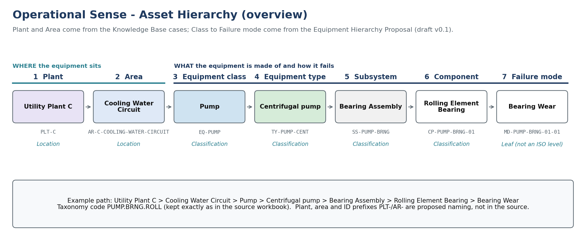
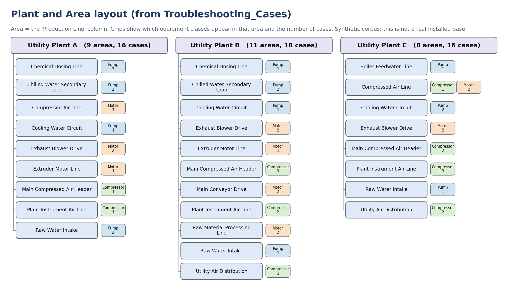
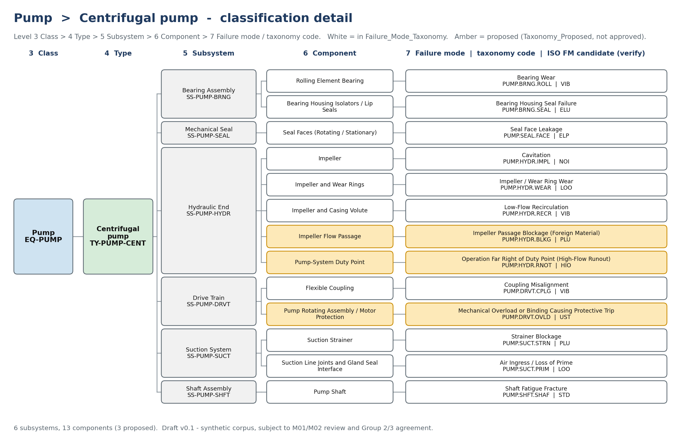
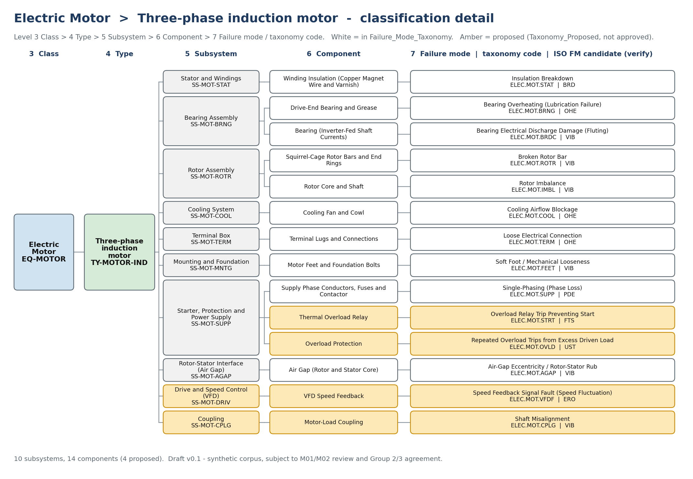
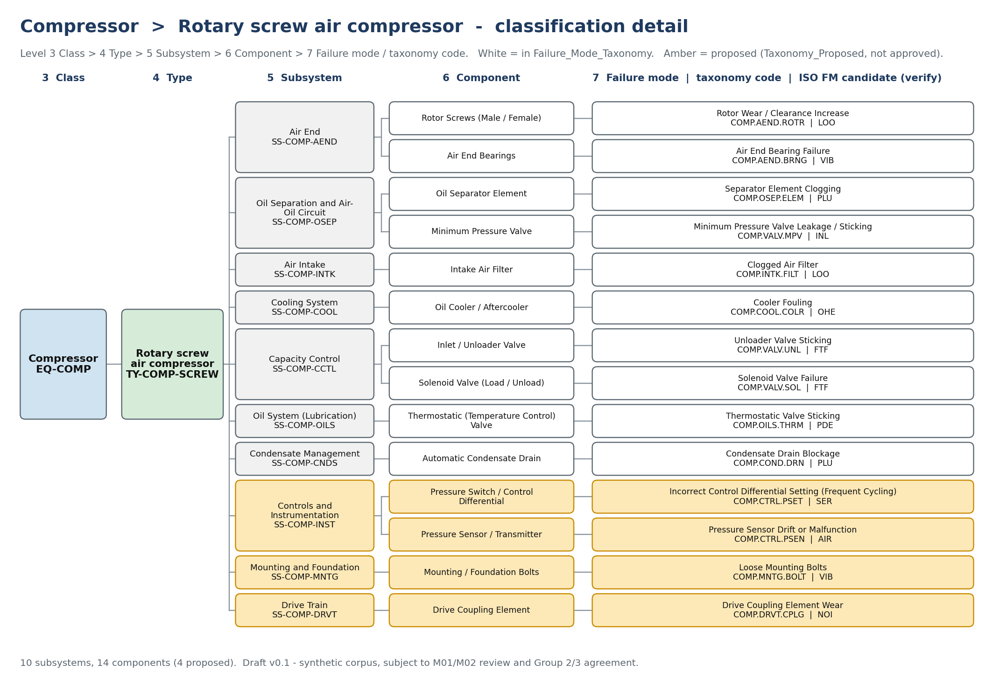

# Operational Sense - Asset Hierarchy

> **Status: DRAFT v0.1.** Built from `Operational_Sense_Equipment_Hierarchy_Proposal.xlsx`, the hierarchy diagram PDF and `Operational_Sense_Industrial_Knowledge_Base_g1.xlsx`. Nothing here is approved by M01/M02 or by Groups 2 and 3. All cases are synthetic; no OEM manual or practitioner review is behind them.

## 1. What an asset hierarchy is here

An asset hierarchy is a parent-child tree that places every machine, part and failure mode in one fixed position. In Operational Sense it lets a technician's captured case be tagged to the exact plant, area, equipment and component it belongs to, so it can be filtered first and then matched by similarity.

The tree has two halves:

- **Location levels (1-2):** *Plant* and *Area*. These come from the `Plant / Facility` and `Production Line` columns of the Knowledge Base cases.
- **Classification levels (3-7):** *Equipment class* down to *Failure mode*. These come from the Equipment Hierarchy Proposal.



## 2. Hierarchy levels

| Level | Name | ID pattern | Source | Notes |
|---|---|---|---|---|
| 1 | Plant | `PLT-<A/B/C>` | Knowledge Base: `Plant / Facility` | 3 plants. **ID pattern proposed here, not in the source.** |
| 2 | Area | `AR-<plant>-<AREA-NAME>` | Knowledge Base: `Production Line` | 28 plant-area pairs. Same area name repeats across plants, so the ID carries the plant. **ID pattern proposed here.** |
| 3 | Equipment class | `EQ-PUMP`, `EQ-MOTOR`, `EQ-COMP` | Hierarchy Proposal | Existing IDs, unchanged (already `equipment_class_id` in `Import_View`). |
| 4 | Equipment type | `TY-<CLASS>-<TYPE>` | Hierarchy Proposal | Source workbook calls this level 'Equipment Class'. |
| 5 | Subsystem | `SS-<CLASS>-<SUB>` | Hierarchy Proposal | Some subsystems are merges of overlapping source names. |
| 6 | Component | `CP-<CLASS>-<SUB>-<nn>` | Hierarchy Proposal | Maintainable item. Carries the taxonomy code. |
| 7 | Failure mode | `MD-<CLASS>-<SUB>-<nn>-<nn>` | Hierarchy Proposal | Leaf node. Not a hierarchy level in ISO 14224; kept so it can be filtered. `MD-` avoids clashing with `FM-xxx` vocabulary IDs. |

Taxonomy codes (for example `PUMP.BRNG.ROLL`, `ELEC.MOT.STAT`) are kept exactly as in the source workbook. ISO failure-mode codes shown below are **candidates only** and must be verified by M01 against ISO 14224 Annex B.

## 3. Plant and Area (levels 1-2)

Areas are listed as they appear in the 50 synthetic cases. The classes shown are the equipment classes that have at least one case in that area. This is **not** a real installed base.



### Utility Plant A (`PLT-A`) - 9 areas, 16 cases

| Area | Area ID | Equipment classes seen (cases) |
|---|---|---|
| Chemical Dosing Line | `AR-A-CHEMICAL-DOSING-LINE` | Pump (3) |
| Chilled Water Secondary Loop | `AR-A-CHILLED-WATER-SECONDARY-LOOP` | Pump (2) |
| Compressed Air Line | `AR-A-COMPRESSED-AIR-LINE` | Motor (3) |
| Cooling Water Circuit | `AR-A-COOLING-WATER-CIRCUIT` | Pump (1) |
| Exhaust Blower Drive | `AR-A-EXHAUST-BLOWER-DRIVE` | Motor (2) |
| Extruder Motor Line | `AR-A-EXTRUDER-MOTOR-LINE` | Motor (1) |
| Main Compressed Air Header | `AR-A-MAIN-COMPRESSED-AIR-HEADER` | Compressor (1) |
| Plant Instrument Air Line | `AR-A-PLANT-INSTRUMENT-AIR-LINE` | Compressor (1) |
| Raw Water Intake | `AR-A-RAW-WATER-INTAKE` | Pump (2) |

### Utility Plant B (`PLT-B`) - 11 areas, 18 cases

| Area | Area ID | Equipment classes seen (cases) |
|---|---|---|
| Chemical Dosing Line | `AR-B-CHEMICAL-DOSING-LINE` | Pump (1) |
| Chilled Water Secondary Loop | `AR-B-CHILLED-WATER-SECONDARY-LOOP` | Pump (2) |
| Cooling Water Circuit | `AR-B-COOLING-WATER-CIRCUIT` | Pump (1) |
| Exhaust Blower Drive | `AR-B-EXHAUST-BLOWER-DRIVE` | Motor (2) |
| Extruder Motor Line | `AR-B-EXTRUDER-MOTOR-LINE` | Motor (1) |
| Main Compressed Air Header | `AR-B-MAIN-COMPRESSED-AIR-HEADER` | Compressor (3) |
| Main Conveyor Drive | `AR-B-MAIN-CONVEYOR-DRIVE` | Motor (2) |
| Plant Instrument Air Line | `AR-B-PLANT-INSTRUMENT-AIR-LINE` | Compressor (2) |
| Raw Material Processing Line | `AR-B-RAW-MATERIAL-PROCESSING-LINE` | Motor (2) |
| Raw Water Intake | `AR-B-RAW-WATER-INTAKE` | Pump (1) |
| Utility Air Distribution | `AR-B-UTILITY-AIR-DISTRIBUTION` | Compressor (1) |

### Utility Plant C (`PLT-C`) - 8 areas, 16 cases

| Area | Area ID | Equipment classes seen (cases) |
|---|---|---|
| Boiler Feedwater Line | `AR-C-BOILER-FEEDWATER-LINE` | Pump (1) |
| Compressed Air Line | `AR-C-COMPRESSED-AIR-LINE` | Compressor (1), Motor (2) |
| Cooling Water Circuit | `AR-C-COOLING-WATER-CIRCUIT` | Pump (2) |
| Exhaust Blower Drive | `AR-C-EXHAUST-BLOWER-DRIVE` | Motor (2) |
| Main Compressed Air Header | `AR-C-MAIN-COMPRESSED-AIR-HEADER` | Compressor (2) |
| Plant Instrument Air Line | `AR-C-PLANT-INSTRUMENT-AIR-LINE` | Compressor (3) |
| Raw Water Intake | `AR-C-RAW-WATER-INTAKE` | Pump (1) |
| Utility Air Distribution | `AR-C-UTILITY-AIR-DISTRIBUTION` | Compressor (2) |

## 4. Equipment classification (levels 3-7)

Colour key in the diagrams: white boxes are in `Failure_Mode_Taxonomy`; amber boxes are **proposed** rows from `Taxonomy_Proposed` (not approved).

### 4.1 Pump > Centrifugal pump

`EQ-PUMP` > `TY-PUMP-CENT` - 6 subsystems, 13 components (3 proposed).



| Subsystem | Component | Failure mode | Taxonomy code | ISO FM (verify) | Status |
|---|---|---|---|---|---|
| Bearing Assembly (`SS-PUMP-BRNG`) | Rolling Element Bearing (`CP-PUMP-BRNG-01`) | Bearing Wear (`MD-PUMP-BRNG-01-01`) | `PUMP.BRNG.ROLL` | VIB | In taxonomy |
| Bearing Assembly (`SS-PUMP-BRNG`) | Bearing Housing Isolators / Lip Seals (`CP-PUMP-BRNG-02`) | Bearing Housing Seal Failure (`MD-PUMP-BRNG-02-01`) | `PUMP.BRNG.SEAL` | ELU | In taxonomy |
| Mechanical Seal (`SS-PUMP-SEAL`) | Seal Faces (Rotating / Stationary) (`CP-PUMP-SEAL-01`) | Seal Face Leakage (`MD-PUMP-SEAL-01-01`) | `PUMP.SEAL.FACE` | ELP | In taxonomy |
| Hydraulic End (`SS-PUMP-HYDR`) | Impeller (`CP-PUMP-HYDR-01`) | Cavitation (`MD-PUMP-HYDR-01-01`) | `PUMP.HYDR.IMPL` | NOI | In taxonomy |
| Hydraulic End (`SS-PUMP-HYDR`) | Impeller and Wear Rings (`CP-PUMP-HYDR-02`) | Impeller / Wear Ring Wear (`MD-PUMP-HYDR-02-01`) | `PUMP.HYDR.WEAR` | LOO | In taxonomy |
| Hydraulic End (`SS-PUMP-HYDR`) | Impeller and Casing Volute (`CP-PUMP-HYDR-03`) | Low-Flow Recirculation (`MD-PUMP-HYDR-03-01`) | `PUMP.HYDR.RECR` | VIB | In taxonomy |
| Hydraulic End (`SS-PUMP-HYDR`) | Impeller Flow Passage (`CP-PUMP-HYDR-04`) | Impeller Passage Blockage (Foreign Material) (`MD-PUMP-HYDR-04-01`) | `PUMP.HYDR.BLKG` | PLU | Proposed |
| Hydraulic End (`SS-PUMP-HYDR`) | Pump-System Duty Point (`CP-PUMP-HYDR-05`) | Operation Far Right of Duty Point (High-Flow Runout) (`MD-PUMP-HYDR-05-01`) | `PUMP.HYDR.RNOT` | HIO | Proposed |
| Drive Train (`SS-PUMP-DRVT`) | Flexible Coupling (`CP-PUMP-DRVT-01`) | Coupling Misalignment (`MD-PUMP-DRVT-01-01`) | `PUMP.DRVT.CPLG` | VIB | In taxonomy |
| Drive Train (`SS-PUMP-DRVT`) | Pump Rotating Assembly / Motor Protection (`CP-PUMP-DRVT-02`) | Mechanical Overload or Binding Causing Protective Trip (`MD-PUMP-DRVT-02-01`) | `PUMP.DRVT.OVLD` | UST | Proposed |
| Suction System (`SS-PUMP-SUCT`) | Suction Strainer (`CP-PUMP-SUCT-01`) | Strainer Blockage (`MD-PUMP-SUCT-01-01`) | `PUMP.SUCT.STRN` | PLU | In taxonomy |
| Suction System (`SS-PUMP-SUCT`) | Suction Line Joints and Gland Seal Interface (`CP-PUMP-SUCT-02`) | Air Ingress / Loss of Prime (`MD-PUMP-SUCT-02-01`) | `PUMP.SUCT.PRIM` | LOO | In taxonomy |
| Shaft Assembly (`SS-PUMP-SHFT`) | Pump Shaft (`CP-PUMP-SHFT-01`) | Shaft Fatigue Fracture (`MD-PUMP-SHFT-01-01`) | `PUMP.SHFT.SHAF` | STD | In taxonomy |

### 4.2 Electric Motor > Three-phase induction motor

`EQ-MOTOR` > `TY-MOTOR-IND` - 10 subsystems, 14 components (4 proposed).



| Subsystem | Component | Failure mode | Taxonomy code | ISO FM (verify) | Status |
|---|---|---|---|---|---|
| Stator and Windings (`SS-MOT-STAT`) | Winding Insulation (Copper Magnet Wire and Varnish) (`CP-MOT-STAT-01`) | Insulation Breakdown (`MD-MOT-STAT-01-01`) | `ELEC.MOT.STAT` | BRD | In taxonomy |
| Bearing Assembly (`SS-MOT-BRNG`) | Drive-End Bearing and Grease (`CP-MOT-BRNG-01`) | Bearing Overheating (Lubrication Failure) (`MD-MOT-BRNG-01-01`) | `ELEC.MOT.BRNG` | OHE | In taxonomy |
| Bearing Assembly (`SS-MOT-BRNG`) | Bearing (Inverter-Fed Shaft Currents) (`CP-MOT-BRNG-02`) | Bearing Electrical Discharge Damage (Fluting) (`MD-MOT-BRNG-02-01`) | `ELEC.MOT.BRDC` | VIB | In taxonomy |
| Rotor Assembly (`SS-MOT-ROTR`) | Squirrel-Cage Rotor Bars and End Rings (`CP-MOT-ROTR-01`) | Broken Rotor Bar (`MD-MOT-ROTR-01-01`) | `ELEC.MOT.ROTR` | VIB | In taxonomy |
| Rotor Assembly (`SS-MOT-ROTR`) | Rotor Core and Shaft (`CP-MOT-ROTR-02`) | Rotor Imbalance (`MD-MOT-ROTR-02-01`) | `ELEC.MOT.IMBL` | VIB | In taxonomy |
| Cooling System (`SS-MOT-COOL`) | Cooling Fan and Cowl (`CP-MOT-COOL-01`) | Cooling Airflow Blockage (`MD-MOT-COOL-01-01`) | `ELEC.MOT.COOL` | OHE | In taxonomy |
| Terminal Box (`SS-MOT-TERM`) | Terminal Lugs and Connections (`CP-MOT-TERM-01`) | Loose Electrical Connection (`MD-MOT-TERM-01-01`) | `ELEC.MOT.TERM` | OHE | In taxonomy |
| Mounting and Foundation (`SS-MOT-MNTG`) | Motor Feet and Foundation Bolts (`CP-MOT-MNTG-01`) | Soft Foot / Mechanical Looseness (`MD-MOT-MNTG-01-01`) | `ELEC.MOT.FEET` | VIB | In taxonomy |
| Starter, Protection and Power Supply (`SS-MOT-SUPP`) | Supply Phase Conductors, Fuses and Contactor (`CP-MOT-SUPP-01`) | Single-Phasing (Phase Loss) (`MD-MOT-SUPP-01-01`) | `ELEC.MOT.SUPP` | PDE | In taxonomy |
| Starter, Protection and Power Supply (`SS-MOT-SUPP`) | Thermal Overload Relay (`CP-MOT-SUPP-02`) | Overload Relay Trip Preventing Start (`MD-MOT-SUPP-02-01`) | `ELEC.MOT.STRT` | FTS | Proposed |
| Starter, Protection and Power Supply (`SS-MOT-SUPP`) | Overload Protection (`CP-MOT-SUPP-03`) | Repeated Overload Trips from Excess Driven Load (`MD-MOT-SUPP-03-01`) | `ELEC.MOT.OVLD` | UST | Proposed |
| Rotor-Stator Interface (Air Gap) (`SS-MOT-AGAP`) | Air Gap (Rotor and Stator Core) (`CP-MOT-AGAP-01`) | Air-Gap Eccentricity / Rotor-Stator Rub (`MD-MOT-AGAP-01-01`) | `ELEC.MOT.AGAP` | VIB | In taxonomy |
| Drive and Speed Control (VFD) (`SS-MOT-DRIV`) | VFD Speed Feedback (`CP-MOT-DRIV-01`) | Speed Feedback Signal Fault (Speed Fluctuation) (`MD-MOT-DRIV-01-01`) | `ELEC.MOT.VFDF` | ERO | Proposed |
| Coupling (`SS-MOT-CPLG`) | Motor-Load Coupling (`CP-MOT-CPLG-01`) | Shaft Misalignment (`MD-MOT-CPLG-01-01`) | `ELEC.MOT.CPLG` | VIB | Proposed |

### 4.3 Compressor > Rotary screw air compressor

`EQ-COMP` > `TY-COMP-SCREW` - 10 subsystems, 14 components (4 proposed).



| Subsystem | Component | Failure mode | Taxonomy code | ISO FM (verify) | Status |
|---|---|---|---|---|---|
| Air End (`SS-COMP-AEND`) | Rotor Screws (Male / Female) (`CP-COMP-AEND-01`) | Rotor Wear / Clearance Increase (`MD-COMP-AEND-01-01`) | `COMP.AEND.ROTR` | LOO | In taxonomy |
| Air End (`SS-COMP-AEND`) | Air End Bearings (`CP-COMP-AEND-02`) | Air End Bearing Failure (`MD-COMP-AEND-02-01`) | `COMP.AEND.BRNG` | VIB | In taxonomy |
| Oil Separation and Air-Oil Circuit (`SS-COMP-OSEP`) | Oil Separator Element (`CP-COMP-OSEP-01`) | Separator Element Clogging (`MD-COMP-OSEP-01-01`) | `COMP.OSEP.ELEM` | PLU | In taxonomy |
| Oil Separation and Air-Oil Circuit (`SS-COMP-OSEP`) | Minimum Pressure Valve (`CP-COMP-OSEP-02`) | Minimum Pressure Valve Leakage / Sticking (`MD-COMP-OSEP-02-01`) | `COMP.VALV.MPV` | INL | In taxonomy |
| Air Intake (`SS-COMP-INTK`) | Intake Air Filter (`CP-COMP-INTK-01`) | Clogged Air Filter (`MD-COMP-INTK-01-01`) | `COMP.INTK.FILT` | LOO | In taxonomy |
| Cooling System (`SS-COMP-COOL`) | Oil Cooler / Aftercooler (`CP-COMP-COOL-01`) | Cooler Fouling (`MD-COMP-COOL-01-01`) | `COMP.COOL.COLR` | OHE | In taxonomy |
| Capacity Control (`SS-COMP-CCTL`) | Inlet / Unloader Valve (`CP-COMP-CCTL-01`) | Unloader Valve Sticking (`MD-COMP-CCTL-01-01`) | `COMP.VALV.UNL` | FTF | In taxonomy |
| Capacity Control (`SS-COMP-CCTL`) | Solenoid Valve (Load / Unload) (`CP-COMP-CCTL-02`) | Solenoid Valve Failure (`MD-COMP-CCTL-02-01`) | `COMP.VALV.SOL` | FTF | In taxonomy |
| Oil System (Lubrication) (`SS-COMP-OILS`) | Thermostatic (Temperature Control) Valve (`CP-COMP-OILS-01`) | Thermostatic Valve Sticking (`MD-COMP-OILS-01-01`) | `COMP.OILS.THRM` | PDE | In taxonomy |
| Condensate Management (`SS-COMP-CNDS`) | Automatic Condensate Drain (`CP-COMP-CNDS-01`) | Condensate Drain Blockage (`MD-COMP-CNDS-01-01`) | `COMP.COND.DRN` | PLU | In taxonomy |
| Controls and Instrumentation (`SS-COMP-INST`) | Pressure Switch / Control Differential (`CP-COMP-INST-01`) | Incorrect Control Differential Setting (Frequent Cycling) (`MD-COMP-INST-01-01`) | `COMP.CTRL.PSET` | SER | Proposed |
| Controls and Instrumentation (`SS-COMP-INST`) | Pressure Sensor / Transmitter (`CP-COMP-INST-02`) | Pressure Sensor Drift or Malfunction (`MD-COMP-INST-02-01`) | `COMP.CTRL.PSEN` | AIR | Proposed |
| Mounting and Foundation (`SS-COMP-MNTG`) | Mounting / Foundation Bolts (`CP-COMP-MNTG-01`) | Loose Mounting Bolts (`MD-COMP-MNTG-01-01`) | `COMP.MNTG.BOLT` | VIB | Proposed |
| Drive Train (`SS-COMP-DRVT`) | Drive Coupling Element (`CP-COMP-DRVT-01`) | Drive Coupling Element Wear (`MD-COMP-DRVT-01-01`) | `COMP.DRVT.CPLG` | NOI | Proposed |

## 5. How a case attaches to the tree

Each Knowledge Base case already carries `plant_facility`, `production_line`, `equipment_class_id`, `subsystem`, `component` and `taxonomy_code`. A case therefore resolves to one path:

```
Utility Plant C > Cooling Water Circuit > Pump > Centrifugal pump > Bearing Assembly > Rolling Element Bearing > Bearing Wear
   PLT-C           AR-C-COOLING-WATER-CIRCUIT  EQ-PUMP   TY-PUMP-CENT     SS-PUMP-BRNG      CP-PUMP-BRNG-01          MD-PUMP-BRNG-01-01
```

Retrieval can filter on plant, area, class and subsystem first, then run similarity within that set.

## 6. Open decisions

These come from the `Open_Issues` sheet of the Hierarchy Proposal; the plant and area items are new.

- Class vs type: ISO 14224 treats Pump as the class and centrifugal as a type; this document follows that.
- Subsystem merges (pump suction, motor power supply and protection, compressor oil separation and controls) need M01/M02 confirmation.
- Taxonomy code patterns differ between pump/compressor and motor codes (Group 2 and 3 agreement needed to rename).
- Composite component names (for example 'Impeller and Wear Rings') should probably be split into atomic components.
- Pump vs driver boundary: the overload-protection component under the pump Drive Train may belong to the motor.
- Coupling appears in all three classes as separate nodes.
- ISO failure-mode codes are unverified candidates.
- **New - plant and area IDs:** `PLT-` and `AR-` patterns are proposed here; confirm naming with M01 and Group 2.
- **New - equipment instances:** the source has equipment models (for example Kirloskar DB-100) but no equipment tags. A tag level between Area and Equipment class may be needed for a real plant.
- **New - area names:** the same area name is used in several plants, and the case areas are synthetic, so the plant-area table is a seed list, not a site survey.

## 7. Diagram files

- [Overview](images/01_asset-hierarchy-overview.png)
- [Plant and area layout](images/02_plant-area-layout.png)
- [Pump - centrifugal](images/03_pump-centrifugal-hierarchy.png)
- [Electric motor - induction](images/04_motor-induction-hierarchy.png)
- [Compressor - rotary screw](images/05_compressor-screw-hierarchy.png)

## 8. Source files

- [Hierarchy diagram (PDF)](../../services/backend/src/modules/sources/Operational_Sense_Hierarchy_Diagram.pdf)
- [Equipment hierarchy proposal (XLSX)](../../services/backend/src/modules/sources/Operational_Sense_Equipment_Hierarchy_Proposal.xlsx)
- [Industrial knowledge base g1 (XLSX)](../../services/backend/src/modules/sources/Operational_Sense_Industrial_Knowledge_Base_g1.xlsx)
